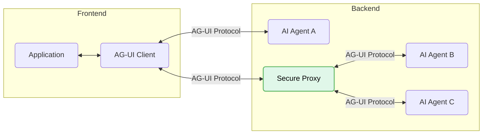

Agent User Interaction Protocol（AG-UI）构建在灵活、事件（event）驱动的架构之上，使前端（front-end）应用与 AI Agent 之间能够进行顺畅、高效的通信。本文介绍其核心架构组件与概念。

## 设计原则

AG-UI 的设计目标是轻量、尽量少的立场预设，从而易于与各类 Agent 实现集成。协议的灵活性来自它简单的要求：

1. **事件（event）驱动通信**：Agent 在执行过程中需要发出 16 种标准化事件（event）类型中的任意一种，从而产生客户端（client）可以处理的更新流。

2. **双向交互**：Agent 接受来自用户的输入，从而支持人与 AI 无缝协作的协同式工作流。

协议内置了一个中间件（middleware）层，通过两种关键方式最大化兼容性：

- **灵活的事件（event）结构**：事件（event）不必与 AG-UI 的格式完全一致——只需要"AG-UI 兼容"。这使既有 Agent 框架能以极小的代价适配其原生事件（event）格式。

- **传输无关（transport-agnostic）**：AG-UI 不规定事件（event）如何传递，支持多种传输（transport）机制，包括 Server-Sent Events（SSE）、webhook、WebSocket 等。这种灵活性让开发者可以选择最贴合自身架构的传输（transport）方式。

这种务实的设计使 AG-UI 易于采用，无需对既有 Agent 实现或前端（frontend）应用做大幅改动。

## 架构总览

AG-UI 采用客户端（client）-服务端（server）架构，标准化 Agent 与应用之间的通信：



- **Application（应用）**：面向用户的应用程序（例如聊天应用，或任何启用了 AI 的应用）。
- **AG-UI Client（AG-UI 客户端（client））**：通用通信客户端（client），如 `HttpAgent`，或用于连接既有协议的专用客户端（client）。
- **Agents（Agent）**：处理后端请求并生成流式响应的后端 AI Agent。
- **Secure Proxy（安全代理）**：提供额外能力（capability）并充当安全代理的后端服务。

## 核心组件

### 协议层

AG-UI 的协议层为 Agent 通信提供了灵活的基础。

- **通用兼容性**：通过实现 `run(input: RunAgentInput) -> Observable<BaseEvent>`，即可连接任意协议

协议的首要抽象让应用能够运行（run） Agent 并接收事件（event）流：

<!-- prettier-ignore -->
```typescript
// Core agent execution interface
type RunAgent = () => Observable<BaseEvent>

class MyAgent extends AbstractAgent {
  run(input: RunAgentInput): RunAgent {
    const { threadId, runId } = input
    return () =>
      from([
        { type: EventType.RUN_STARTED, threadId, runId },
        {
          type: EventType.MESSAGES_SNAPSHOT,
          messages: [
            { id: "msg_1", role: "assistant", content: "Hello, world!" }
          ],
        },
        { type: EventType.RUN_FINISHED, threadId, runId },
      ])
  }
}
```

### 标准 HTTP 客户端（client）

AG-UI 提供标准 HTTP 客户端（client） `HttpAgent`，可用于连接任何接受 POST 请求（请求体类型为 `RunAgentInput`）并返回 `BaseEvent` 对象流的端点。

`HttpAgent` 支持以下传输（transport）方式：

- **HTTP SSE（Server-Sent Events）**

  - 基于文本的流式（streaming），兼容性广
  - 易于阅读与调试

- **HTTP 二进制（binary）协议**
  - 高性能、高空间利用率的自定义传输（transport）
  - 面向生产环境的稳健二进制（binary）序列化（serialization）

### 消息（message）类型

AG-UI 为 Agent 通信的不同方面定义了几类事件（event）：

- **生命周期事件（event）**

  - `RUN_STARTED`、`RUN_FINISHED`、`RUN_ERROR`
  - `STEP_STARTED`、`STEP_FINISHED`

- **文本消息（text message）事件（event）**

  - `TEXT_MESSAGE_START`、`TEXT_MESSAGE_CONTENT`、`TEXT_MESSAGE_END`

- **工具调用（tool call）事件（event）**

  - `TOOL_CALL_START`、`TOOL_CALL_ARGS`、`TOOL_CALL_END`

- **状态（state）管理事件（event）**

  - `STATE_SNAPSHOT`、`STATE_DELTA`、`MESSAGES_SNAPSHOT`

- **特殊事件（event）**
  - `RAW`、`CUSTOM`

## 运行（run） Agent

要运行（run）一个 Agent，你需要创建客户端（client）实例并执行它：

```typescript
// Create an HTTP agent client
const agent = new HttpAgent({
  url: "https://your-agent-endpoint.com/agent",
  agentId: "unique-agent-id",
  threadId: "conversation-thread"
});

// Start the agent and handle events
agent.runAgent({
  tools: [...],
  context: [...]
}).subscribe({
  next: (event) => {
    // Handle different event types
    switch(event.type) {
      case EventType.TEXT_MESSAGE_CONTENT:
        // Update UI with new content
        break;
      // Handle other event types
    }
  },
  error: (error) => console.error("Agent error:", error),
  complete: () => console.log("Agent run complete")
});
```

## 状态（state）管理

AG-UI 通过专门的事件（event）提供高效的状态（state）管理：

- `STATE_SNAPSHOT`：某一时刻的完整状态（state）表示
- `STATE_DELTA`：使用 JSON Patch 格式（RFC 6902）的增量（delta）状态（state）变更
- `MESSAGES_SNAPSHOT`：完整的对话历史

这些事件（event）以最小的数据传输量实现高效的客户端（client）状态（state）管理。

## 工具与交接（Handoff）

AG-UI 通过标准化事件（event）支持 Agent 之间的交接以及工具使用：

- 工具定义通过 `runAgent` 的参数传入
- 工具调用（tool call）以 `TOOL_CALL_START` → `TOOL_CALL_ARGS` → `TOOL_CALL_END` 的事件（event）序列流式发出（streamed）
- Agent 可以交接给其他 Agent，并保持上下文的连续性

## 事件（event）

AG-UI 中的所有通信都基于类型化事件（event）。每个事件（event）都继承自 `BaseEvent`：

```typescript
interface BaseEvent {
  type: EventType
  timestamp?: number
  rawEvent?: any
}
```

事件（event）经过严格的类型定义与校验，确保组件之间通信的可靠性。
