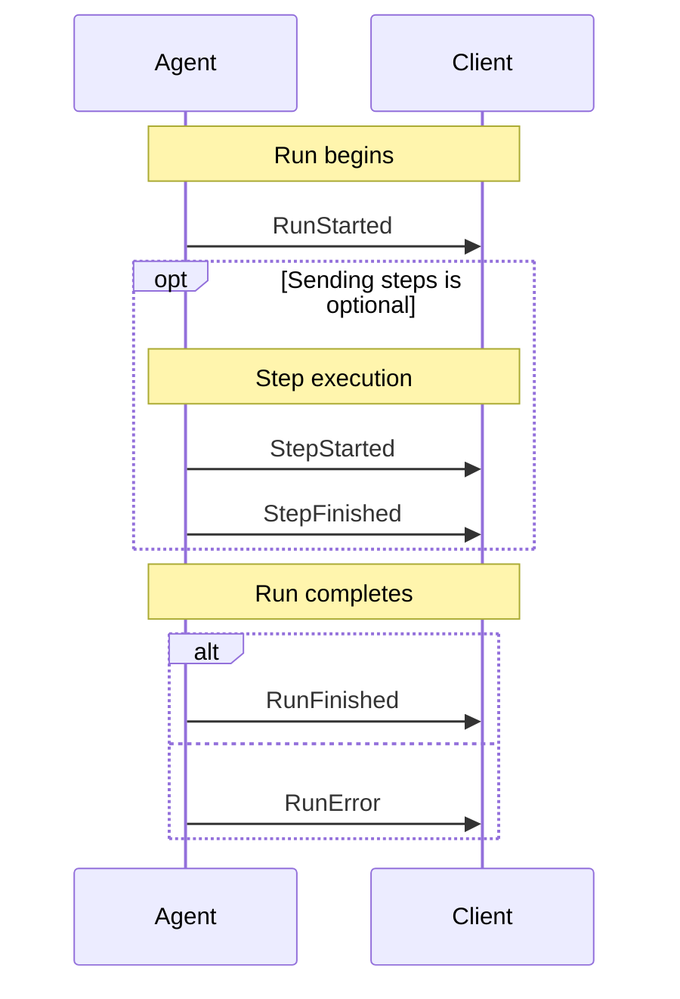
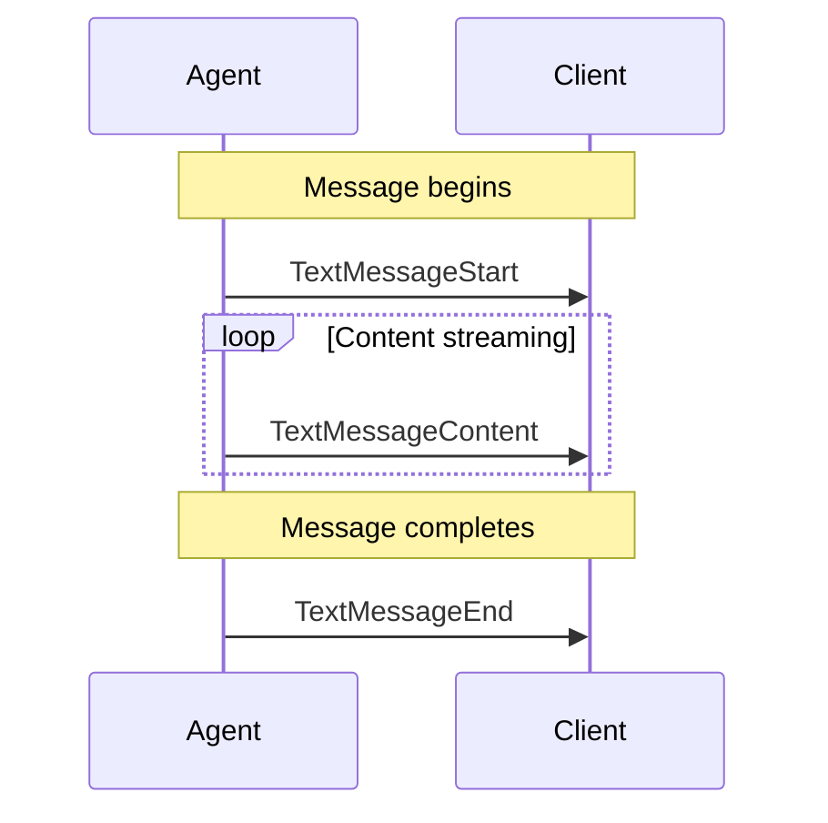
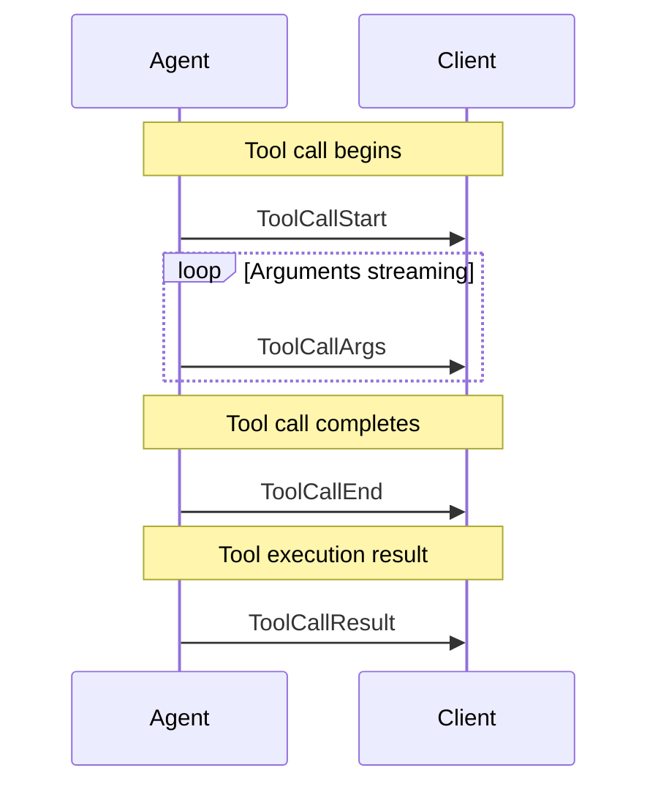
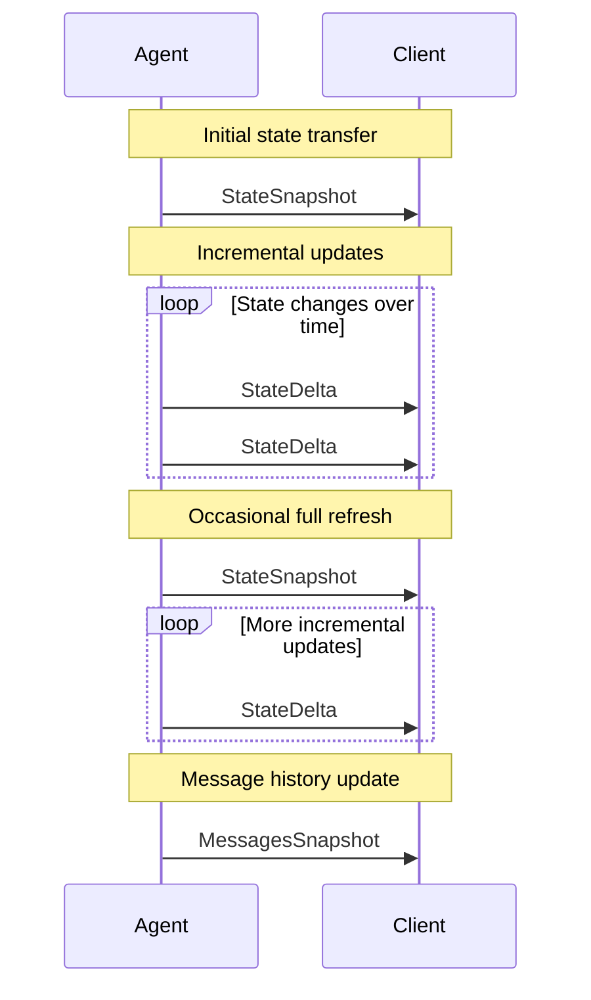
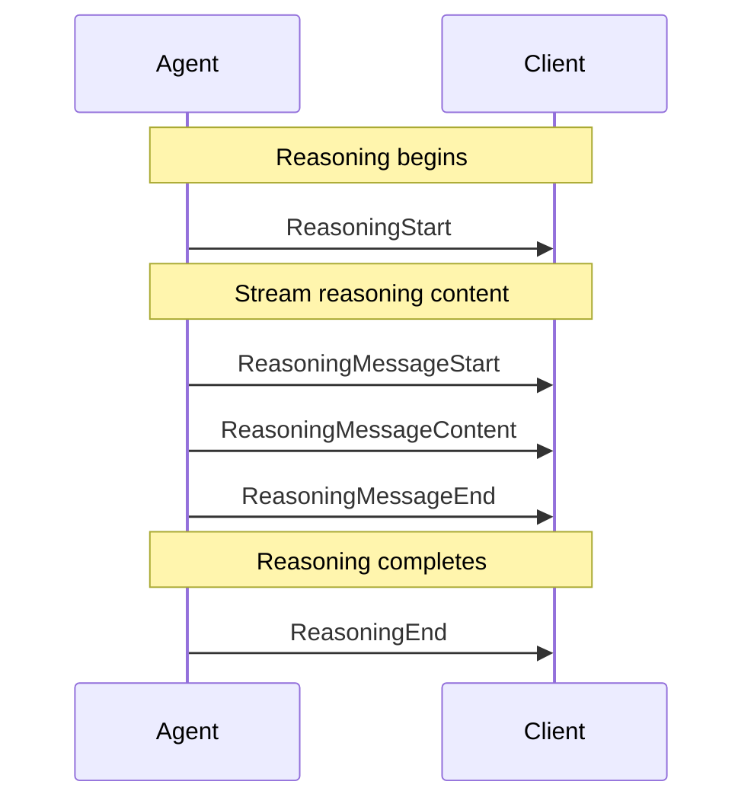
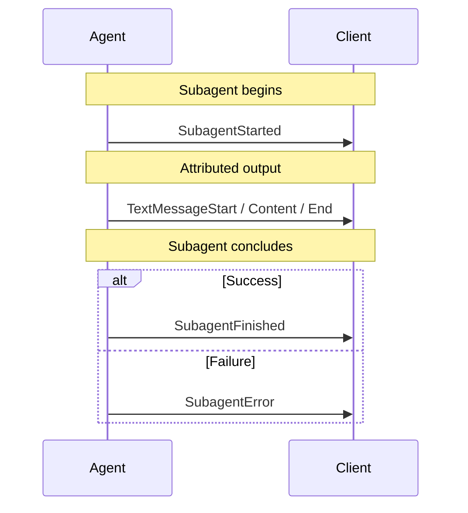

# 事件（event）

Agent User Interaction Protocol 采用基于事件（event）的流式架构。事件（event）是 Agent 与前端（frontend）之间通信的基本单元，使实时、结构化的交互成为可能。

## 事件（event）类型总览

协议中的事件（event）按其用途分类：

| 类别 | 说明 |
| ----------------------- | --------------------------------------- |
| 生命周期事件（event） | 监控 Agent 运行（run）的推进过程 |
| 文本消息（text message）事件（event） | 处理流式文本内容 |
| 工具调用（tool call）事件（event） | 管理 Agent 发起的工具执行 |
| 状态（state）管理事件（event） | 在 Agent 与 UI 之间同步状态（state） |
| 活动（activity）事件（event） | 表示进行中的活动（activity）进度 |
| 子 Agent（subagent）事件（event） | 跟踪子 Agent（subagent）并归属其输出 |
| 特殊事件（event） | 支持自定义功能 |
| 草案事件（event） | 开发中、尚在提案阶段的事件（event） |

## 基础事件（event）属性

所有事件（event）共享一组通用的基础属性：

| 属性 | 说明 |
| ----------- | ---------------------------------------------------------------- |
| `type` | 具体的事件（event）类型标识 |
| `timestamp` | 可选的时间戳，表示事件（event）创建的时间 |
| `rawEvent` | 可选字段，若事件（event）经过转换，则包含原始事件（event）数据 |
| `metadata` | 可选字段，附加到事件（event）上的额外信息 |

### 元数据（Metadata）

`metadata` 是一个可选的、按 key 开放的对象，用于向事件（event）附加额外信息——token 用量、trace id、结束原因。它只在基础事件（event）上声明一次，因此每种事件（event）类型都携带它。

消费者（consumer）会把事件（event）的 metadata 逐个 key 合并进该事件（event）所构建的消息（message），后写覆盖先写。正因如此，生产者（producer）可以在消息（message）的最后一个事件（event）上发送 token 用量，而不必事先就知道它。

完整规则见 [元数据（Metadata）](metadata.md)：保留的 `ag-ui` 键、哪些事件（event）会合并metadata 而哪些不会、工具调用（tool call）如何携带自己的 metadata，以及该对象在不同传输（transport）下的行为。

大多数事件（event）还接受一个可选的 `subagentRunId`，用于标识产生该事件（event）的子 Agent（subagent）。不带它的事件（event）归属于父 Agent。见[子 Agent（subagent）](subagents.md)。

## 生命周期事件（event）

这些事件（event）表示一次 Agent 运行（run）的生命周期。典型的 Agent 运行（run）遵循可预测的模式：以 `RunStarted` 事件（event）开始，中间可以包含多对可选的 `StepStarted`/`StepFinished`，最后以 `RunFinished` 事件（event）（成功）或 `RunError` 事件（event）（失败）结束。

生命周期事件（event）为 Agent 运行（run）提供了关键结构，使前端（frontend）能够跟踪进度、恰当管理 UI 状态（state）并优雅地处理错误。它们建立了一致的框架，让人们理解操作何时开始、何时结束，从而使加载指示器、进度跟踪与错误恢复机制等功能得以实现。

`RunStarted` 以及 `RunFinished` 或 `RunError` 二者之一是必需的，它们构成一次 Agent 运行（run）的边界（boundary）。步骤（step）事件（event）是可选的，在一次运行（run）中可以出现多次，从而支持结构化、可观测的进度跟踪。

### RunStarted

标志一次 Agent 运行（run）的开始。

`RunStarted` 事件（event）是 Agent 开始处理请求时发出的第一个事件（event）。它建立一个由唯一 `runId` 标识的新执行上下文。该事件（event）是前端（frontend）初始化进度指示器或加载状态（state）等 UI 元素的标记，同时提供关键标识符，用于把后续事件（event）关联到这次特定的运行（run）。

| 属性 | 说明 |
| ------------- | -------------------------------------------------------------------------------------------------------------------------------------------------------------- |
| `threadId`    | 会话线程（thread）的 ID |
| `runId`       | 本次 Agent 运行（run）的 ID |
| `parentRunId` | （可选）用于分支（branching）/时间旅行的谱系指针。若存在，指向同一线程（thread）中的某次先前运行（run），形成类似 git 的只追加日志 |
| `input`       | （可选）本次运行（run）发送给 Agent 的确切输入载荷。可以省略历史中已存在的消息（message）；`compactEvents()` 会做规范化 |

### RunFinished

标志一次 Agent 运行（run）的结束。每次运行（run）都以 `RunFinished` 或 `RunError` 之一终止。

`RunFinished` 有一个可选的 `outcome` 判别联合：

- **省略**——尚未采用中断（interrupt）感知生命周期的旧生产者（producer）。按正常完成处理。
- `outcome: { type: "success" }`——运行（run）正常完成。可选的 `result` 仍留在事件（event）根部以保持向后兼容。
- `outcome: { type: "interrupt", interrupts: [...] }`——运行（run）因等待人类输入而暂停。非空的 `interrupts` 数组位于该 outcome 变体内部。客户端（client）通过发起一次新的运行（run）来恢复（resume），其 `RunAgentInput` 包含一个 `resume` 数组，针对每一个未解决的中断（interrupt）作答。

> [!NOTE]
> 完整的中断（interrupt）生命周期——`Interrupt` 类型、契约规则、错误处理、reason 分类法以及完整示例——见[中断（interrupt）（Interrupts）](interrupts.md)。

### RunError

标志 Agent 运行（run）期间发生错误。

`RunError` 事件（event）表示 Agent 遇到了无法恢复的错误，导致运行（run）提前终止。该事件（event）提供出错信息，使前端（frontend）能够显示恰当的错误消息（message），并可能提供恢复选项。在 `RunError` 事件（event）之后，本次运行（run）不会再有任何处理发生。

| 属性 | 说明 |
| --------- | ------------------- |
| `message` | 错误消息（message） |
| `code`    | 可选的错误码 |

### StepStarted

标志一次 Agent 运行（run）中某个步骤（step）的开始。

`StepStarted` 事件（event）表示 Agent 正在开始某个特定的子任务或处理阶段。步骤（step）提供了对 Agent 进度的细粒度可见性，使 UI 中的跟踪与反馈更为精确。步骤（step）是可选的，但对于那些受益于被拆解为可观测阶段的复杂操作，强烈建议使用。`stepName` 可以是当前正在执行的节点或函数名称。

| 属性 | 说明 |
| ---------- | ---------------- |
| `stepName` | 步骤（step）的名称 |

### StepFinished

标志一次 Agent 运行（run）中某个步骤（step）的完成。

`StepFinished` 事件（event）表示 Agent 已完成某个特定的子任务或阶段。当它与对应的 `StepStarted` 事件（event）配对时，就为一个离散的工作单元划定了有界上下文。前端（frontend）可以利用这些事件（event）更新进度指示器、展示完成动画，或揭示该步骤（step）特有的结果。`stepName` 必须与对应的 `StepStarted` 事件（event）匹配，才能正确配对步骤（step）的开始与结束。

| 属性 | 说明 |
| ---------- | ---------------- |
| `stepName` | 步骤（step）的名称 |

## 文本消息（text message）事件（event）

这些事件（event）表示对话中文本消息（text message）的生命周期。文本消息（text message）事件（event）遵循流式模式，内容被增量（delta）投递。一条消息（message）以 `TextMessageStart` 事件（event）开始，随后是一个或多个 `TextMessageContent` 事件（event）（在文本可用时投递其片段），最后以 `TextMessageEnd` 事件（event）结束。

这种流式方式使消息（message）内容在生成过程中即可实时展示，相比"等整条消息（message）完成后再显示"带来更敏捷的用户体验。

每个 `TextMessageContent` 事件（event）都包含一个 `delta` 字段，携带一段文本。前端（frontend）应按接收顺序拼接这些 delta 来构建完整消息（message）。`messageId` 属性把所有相关事件（event）串联起来，让前端（frontend）能把内容片段归到正确的消息（message）上。

### TextMessageStart

标志一条文本消息（text message）的开始。

`TextMessageStart` 事件（event）在对话中初始化一条新的文本消息（text message）。它建立一个唯一的 `messageId`，后续的内容片段与结束事件（event）都会引用它。该事件（event）让前端（frontend）能够为即将到来的消息（message）准备 UI，例如创建一个带加载指示器的新消息（message）气泡。`role` 属性标明消息（message）来自 assistant，还是对话中的其他参与者。

| 属性 | 说明 |
| ----------- | ------------------------------------------------------------------------------- |
| `messageId` | 消息（message）的唯一标识符 |
| `role`      | 消息（message）发送者的角色（"developer"、"system"、"assistant"、"user"、"tool"） |

### TextMessageContent

表示流式文本消息（text message）中的一段内容。

`TextMessageContent` 事件（event）在消息（message）文本可用时投递其增量（delta）部分。每个事件（event）的 `delta` 属性包含一小段文本，应当追加到此前已接收的片段之后。这些事件（event）的流式特性使内容可以实时展示，带来更敏捷、更有参与感的用户体验。实现方应高效处理这些事件（event），确保文本渲染流畅，不出现可见的延迟或闪烁。

| 属性 | 说明 |
| ----------- | -------------------------------------- |
| `messageId` | 与 `TextMessageStart` 中的 ID 一致 |
| `delta`     | 文本内容片段（非空） |

### TextMessageEnd

标志一条文本消息（text message）的结束。

`TextMessageEnd` 事件（event）标记一条流式文本消息（text message）的完成。收到该事件（event）后，前端（frontend）便知道消息（message）已完整，不会再有内容追加。这使 UI 能够完成渲染、移除加载指示器，并可能触发消息（message）完成后应发生的动作，例如启用回复控件，或自动滚动以确保整条消息（message）可见。

| 属性 | 说明 |
| ----------- | -------------------------------------- |
| `messageId` | 与 `TextMessageStart` 中的 ID 一致 |

### TextMessageChunk

便捷事件（event），会自动展开为 Start → Content → End。

`TextMessageChunk` 事件（event）让你可以省略显式的 `TextMessageStart` 与 `TextMessageEnd` 事件（event）。客户端（client）流变换器会把 chunk 展开成标准三件套：

- 一条消息（message）的第一个 chunk 必须包含 `messageId`，并会触发 `TextMessageStart`（未提供 role 时默认为 `assistant`）。
- 每个带 `delta` 的 chunk 都会为当前 `messageId` 触发一个 `TextMessageContent`。
- 当流切换到新的 message ID 或流结束时，会自动触发 `TextMessageEnd`。

| 属性 | 说明 |
| ----------- | ------------------------------------------------------------------------------------ |
| `messageId` | 可选的消息（message）唯一标识符；在一条消息（message）的第一个 chunk 上必需 |
| `role`      | 可选的发送者角色（"developer"、"system"、"assistant"、"user"） |
| `delta`     | 可选的消息（message）文本内容 |

## 工具调用（tool call）事件（event）

这些事件（event）表示 Agent 发起工具调用（tool call）的生命周期。工具调用（tool call）遵循与文本消息（text message）相似的流式模式。当 Agent 需要使用某个工具时，它发出 `ToolCallStart` 事件（event），随后是一个或多个 `ToolCallArgs` 事件（event）（流式传输（transport）传给工具的参数），最后以 `ToolCallEnd` 事件（event）结束。

这种流式方式让前端（frontend）可以实时展示工具执行过程，使 Agent 的动作透明化，并就"正在调用什么工具、传了什么参数"提供即时反馈。

每个 `ToolCallArgs` 事件（event）都包含一个 `delta` 字段，携带一段参数。前端（frontend）应按接收顺序拼接这些 delta 来构建完整的参数对象。`toolCallId` 属性把所有相关事件（event）串联起来，让前端（frontend）能把参数片段归到正确的工具调用（tool call）上。

### ToolCallStart

标志一次工具调用（tool call）的开始。

`ToolCallStart` 事件（event）表示 Agent 正在调用某个工具以执行特定功能。该事件（event）提供被调工具的名称，并建立一个唯一的 `toolCallId`，本次工具调用（tool call）的后续事件（event）都会引用它。前端（frontend）可以用该事件（event）向用户显示工具使用情况，例如提示某项特定操作正在进行。可选的 `parentMessageId` 可以把这次工具调用（tool call）关联到对话中的某条特定消息（message），为"为什么使用这个工具"提供上下文。

| 属性 | 说明 |
| ----------------- | ----------------------------------- |
| `toolCallId`      | 工具调用（tool call）的唯一标识符 |
| `toolCallName`    | 被调用的工具名称 |
| `parentMessageId` | 可选的父消息（message） ID |

### ToolCallArgs

表示工具调用（tool call）的一段参数数据。

`ToolCallArgs` 事件（event）在工具参数可用时投递其增量（delta）部分。每个事件（event）的 `delta` 属性包含一段参数数据。这些 delta 通常是 JSON 片段，合并后构成该工具的完整参数对象。对于构造完整参数可能需要时间的复杂工具调用（tool call），流式传输（transport）参数尤其有价值。前端（frontend）可以向用户逐步揭示这些参数，让人了解到底传了哪些参数给工具。

| 属性 | 说明 |
| ------------ | ----------------------------------- |
| `toolCallId` | 与 `ToolCallStart` 中的 ID 一致 |
| `delta`      | 参数数据片段 |

### ToolCallEnd

标志一次工具调用（tool call）的结束。

`ToolCallEnd` 事件（event）标记一次工具调用（tool call）的完成。收到该事件（event）后，前端（frontend）便知道所有参数都已传输（transport）完毕，工具执行正在进行或已完成。这使 UI 能够完成工具调用（tool call）的展示，并为可能的结果做准备。在工具执行结果另行返回的系统中，该事件（event）表示 Agent 已结束对工具及其参数的说明，正在等待或已收到结果。

| 属性 | 说明 |
| ------------ | ----------------------------------- |
| `toolCallId` | 与 `ToolCallStart` 中的 ID 一致 |

### ToolCallResult

提供一次工具调用（tool call）执行的结果。

`ToolCallResult` 事件（event）投递此前由 Agent 调用的工具的输出或结果。该事件（event）在系统执行完工具之后发送，包含工具实际产生的输出。与工具调用（tool call）说明部分的流式模式（start、args、end）不同，结果作为完整单元投递，因为工具执行通常产生完整输出。前端（frontend）可以用该事件（event）向用户展示工具结果（tool result）、将其追加到对话历史，或根据工具输出触发后续动作。

| 属性 | 说明 |
| ------------ | ----------------------------------------------------------- |
| `messageId`  | 该结果所属的对话消息（message） ID |
| `toolCallId` | 与对应的 `ToolCallStart` 事件（event）中的 ID 一致 |
| `content`    | 工具执行产生的实际结果/输出内容 |
| `role`       | 可选的角色标识，工具结果（tool result）通常为 "tool" |

### ToolCallChunk

便捷事件（event），会自动展开为 Start → Args → End。

`ToolCallChunk` 事件（event）让你可以省略显式的 `ToolCallStart` 与 `ToolCallEnd` 事件（event）。客户端（client）流变换器会把 chunk 展开成标准的工具调用（tool call）三件套：

- 一次工具调用（tool call）的第一个 chunk 必须包含 `toolCallId` 与 `toolCallName`，并会触发 `ToolCallStart`（同时传递任何 `parentMessageId`）。
- 每个带 `delta` 的 chunk 都会为当前 `toolCallId` 触发一个 `ToolCallArgs`。
- 当流切换到新的 `toolCallId` 或流结束时，会自动触发 `ToolCallEnd`。

| 属性 | 说明 |
| ----------------- | -------------------------------------------------------------------- |
| `toolCallId`      | 在后续 chunk 上可选；在工具调用（tool call）的第一个 chunk 上必需 |
| `toolCallName`    | 在后续 chunk 上可选；在工具调用（tool call）的第一个 chunk 上必需 |
| `parentMessageId` | 可选的父消息（message） ID |
| `delta`           | 可选的参数数据片段（通常是 JSON 片段） |

## 状态（state）管理事件（event）

这些事件（event）用于管理并同步 Agent 的状态（state）与前端（frontend）。协议中的状态（state）管理遵循高效的快照（snapshot）-增量（delta）（snapshot-delta）模式：完整状态（state）快照（snapshot）在初始或偶尔发送，而持续的变化则使用增量（delta）更新（delta）。

这种方式同时兼顾完整性与效率：快照（snapshot）确保前端（frontend）拥有完整的状态（state）上下文，而 delta 则把频繁更新所需的数据传输（transport）降到最低。二者结合，使前端（frontend）能够在不做多余传输（transport）的前提下，维持对 Agent 状态（state）的准确表示。

快照（snapshot）与增量（delta）的组合使前端（frontend）能够高效跟踪 Agent 状态（state）的变化，同时保证一致性（consistency）。快照（snapshot）作为同步点，把状态（state）重置到一个已知基线；delta 则在快照（snapshot）之间提供轻量更新。

### StateSnapshot

提供 Agent 状态（state）的完整快照（snapshot）。

`StateSnapshot` 事件（event）投递 Agent 当前状态（state）的完整表示。该事件（event）通常在交互开始时或需要同步时发送。它包含与前端（frontend）相关的全部状态（state）变量，使前端（frontend）能够完全重建其内部表示。前端（frontend）应当用该快照（snapshot）的内容替换既有状态（state）模型，而不是试图把它与此前的状态（state）合并。

| 属性 | 说明 |
| ---------- | ----------------------- |
| `snapshot` | 完整的状态（state）快照（snapshot） |

### StateDelta

使用 JSON Patch 提供对 Agent 状态（state）的局部更新。

`StateDelta` 事件（event）以 JSON Patch 操作（按 RFC 6902 定义）的形式，包含对 Agent 状态（state）的增量（delta）更新。每个 delta 表示要应用到当前状态（state）模型上的具体变更。这种方式在带宽上很高效，只发送变化的部分而不是整个状态（state）。前端（frontend）应按顺序应用这些 patch，以维持准确的状态（state）表示。如果前端（frontend）在应用 patch 后发现不一致，可以请求一份新的 `StateSnapshot`。

| 属性 | 说明 |
| -------- | ----------------------------------------- |
| `delta`  | JSON Patch 操作数组（RFC 6902） |

### MessagesSnapshot

提供对话中所有消息（message）的快照（snapshot）。

`MessagesSnapshot` 事件（event）投递当前对话的完整消息（message）历史。与通用状态（state）快照（snapshot）不同，它专门聚焦于对话记录。该事件（event）适用于初始化聊天历史、在连接中断（interruption）后同步，或在用户加入进行中的对话时提供完整视图。前端（frontend）应当用它建立或刷新向用户展示的对话上下文。

| 属性 | 说明 |
| ---------- | ------------------------ |
| `messages` | 消息（message）对象数组 |

在 `MessagesSnapshot` 中，`activity` 与 `reasoning` 消息（message）是全有或全无的。如果快照（snapshot）携带了该角色的任何消息（message），那它就是该角色的完整集合：它重复的条目会替换客户端（client）的副本，它未包含的条目会被移除。如果它一条也没有携带，则说明该快照（snapshot）对该角色不作任何声明，客户端（client）保留已有消息（message）。

这两种角色默认都是客户端（client）侧的，因此省略它们是安全的。活动（activity）消息（message）从不会回到 Agent——它们会从 `RunAgentInput` 中被剥除——而推理（reasoning）通常只以流式的 `Reasoning` 事件（event）存在。两者都不跟踪的后端，只需在快照（snapshot）中省略它们，客户端（client）持有的内容不会因此丢失。

## 活动（activity）事件（event）

活动（activity）事件（event）暴露发生在聊天消息（message）之间的、结构化的进行中活动（activity）更新。它们遵循与状态（state）系统相同的快照（snapshot）/增量（delta）模式，使 UI 可以立即渲染完整的活动（activity）视图，随后在新信息到达时增量（delta）更新它。

活动（activity）消息（message）与所有其他消息（message）处于同一 id 空间，因此它的 `messageId` 不得被文本消息（text message）或推理（reasoning）消息（message）复用，反之亦然。它们携带的是不同形状的 `content`——活动（activity）是结构化对象，文本与推理（reasoning）是字符串——所以共用一个 id 没有自洽的含义。客户端（client）若在某个活动（activity）消息（message）已占用的 id 下收到文本或推理（reasoning）消息（message），应保持该活动（activity）消息（message）不变，而不是覆盖它。

### ActivitySnapshot

投递一条活动（activity）消息（message）的完整快照（snapshot）。

| 属性 | 说明 |
| -------------- | --------------------------------------------------------------------------------------------- |
| `messageId`    | 本事件（event）所更新的 `ActivityMessage` 的标识符 |
| `activityType` | 活动（activity）判别符（例如 `"PLAN"`、`"SEARCH"`） |
| `content`      | 表示完整活动（activity）状态（state）的结构化 JSON 载荷 |
| `replace`      | 可选。默认为 `true`。当为 `false` 时，若消息（message）已存在则忽略该快照（snapshot） |

前端（frontend）应当创建一个新的 `ActivityMessage`，或用快照（snapshot）提供的载荷替换既有的那个。

### ActivityDelta

使用 JSON Patch 操作对既有活动（activity）应用增量（delta）更新。

| 属性 | 说明 |
| -------------- | ------------------------------------------------------------------------ |
| `messageId`    | 目标活动（activity）消息（message）的标识符 |
| `activityType` | 活动（activity）判别符（与最近一次快照（snapshot）中的值一致） |
| `patch`        | 要应用到活动（activity）数据上的 RFC 6902 JSON Patch 操作数组 |

活动（activity） delta 应按顺序应用到此前已同步的活动（activity）内容上。如果应用发现偏离，它可以请求或发出新的 `ActivitySnapshot` 以重新同步。

## 特殊事件（event）

特殊事件（event）通过允许系统特定的功能以及与外部系统的集成，为协议提供了灵活性。这些事件（event）不遵循其他事件（event）类型的标准生命周期或流式模式，而是服务于专门的用途。

### Raw

用于透传（passthrough）来自外部系统的事件（event）。

`Raw` 事件（event）充当一个容器，承载来自外部系统或来源、本身并不原生遵循 Agent UI Protocol 的事件（event）。该事件（event）类型通过把其他基于事件（event）的系统的事件（event）包装成标准格式，实现与它们的互操作。被封装的事件（event）数据以原始形式保存在 `event` 属性中，而可选的 `source` 属性标识其来源系统。前端（frontend）可以利用这些信息恰当处理外部事件（event）——直接处理，或委派给针对特定系统的处理器。

| 属性 | 说明 |
| -------- | -------------------------- |
| `event`  | 原始事件（event）数据 |
| `source` | 可选的来源标识符 |

### Custom

用于应用特定的自定义事件（event）。

`Custom` 事件（event）提供了一种扩展机制，用于实现标准事件（event）类型未覆盖的功能。与作为透传（passthrough）容器的 `Raw` 事件（event）不同，`Custom` 事件（event）明确属于协议的一部分，但语义由应用定义。`name` 属性标识具体的自定义事件（event）类型，`value` 属性包含关联的数据。该机制使协议无需正式修改规范即可扩展。团队应当记录其自定义事件（event），以确保前端（frontend）与 Agent 之间实现一致。

| 属性 | 说明 |
| -------- | ------------------------------- |
| `name`   | 自定义事件（event）的名称 |
| `value`  | 与该事件（event）关联的值 |

## 推理（reasoning）事件（event）

推理（reasoning）事件（event）支持 LLM 推理（reasoning）的可见性与连续性，在保持隐私的同时支持思维链推理（reasoning）。这些事件（event）让 Agent 能够呈现推理（reasoning）信号（例如摘要），并支持加密推理（reasoning）项，以便在轮次之间携带状态（state）——特别是在 `store:false` 或零数据保留策略下——而不暴露原始思维链。

关于加密推理（reasoning）项这一底层概念（本设计即源于它），参见
[OpenAI ZTR 文档](https://developers.openai.com/cookbook/examples/responses_api/reasoning_items/#encrypted-reasoning-items)、
[OpenAI store 参数文档](https://platform.openai.com/docs/api-reference/responses/create#responses_create-store)
以及
[Gemini Thought Signatures](https://ai.google.dev/gemini-api/docs/thought-signatures)。

完整文档（包括隐私考量、合规指引与实现示例）见[推理（Reasoning）](reasoning.md)。

### ReasoningStart

标记推理（reasoning）的开始。

`ReasoningStart` 事件（event）表示 Agent 正在开始一个推理（reasoning）过程。它建立一个由唯一 `messageId` 标识的推理（reasoning）上下文。

| 属性 | 说明 |
| ----------- | ----------------------------------- |
| `messageId` | 本次推理（reasoning）的唯一标识符 |

### ReasoningMessageStart

标志一条推理（reasoning）消息（message）的开始。

`ReasoningMessageStart` 事件（event）开始一条流式推理（reasoning）消息（message）。这条消息（message）将包含应当展示给用户的、Agent 推理（reasoning）中可见的部分（例如摘要或部分思维链）。

| 属性 | 说明 |
| ----------- | --------------------------------------------- |
| `messageId` | 消息（message）的唯一标识符 |
| `role`      | 推理（reasoning）消息（message）的角色（`"reasoning"`） |

### ReasoningMessageContent

表示流式推理（reasoning）消息（message）中的一段内容。

`ReasoningMessageContent` 事件（event）向客户端（client）投递增量（delta）推理（reasoning）内容。具有相同 `messageId` 的多个内容事件（event）应被拼接起来，形成完整的可见推理（reasoning）。

| 属性 | 说明 |
| ----------- | ------------------------------------------ |
| `messageId` | 与 ReasoningMessageStart 中的 ID 一致 |
| `delta`     | 推理（reasoning）内容片段（非空字符串） |

### ReasoningMessageEnd

标志一条推理（reasoning）消息（message）的结束。

`ReasoningMessageEnd` 事件（event）表示指定推理（reasoning）消息（message）的所有内容都已发送。客户端（client）应当完成所有表示该推理（reasoning）消息（message）的 UI。

| 属性 | 说明 |
| ----------- | ------------------------------------- |
| `messageId` | 与 ReasoningMessageStart 中的 ID 一致 |

### ReasoningMessageChunk

用于自动开始/关闭推理（reasoning）消息（message）的便捷事件（event）。

`ReasoningMessageChunk` 事件（event）通过自动管理消息（message）生命周期来简化实现。第一个带有 `messageId` 的 chunk 隐式开启该消息（message）。空的 `delta` 或下一个非推理（reasoning）事件（event）会隐式关闭该消息（message）。

| 属性 | 说明 |
| ----------- | --------------------------------------------------------- |
| `messageId` | 消息（message） ID（第一个事件（event）必须非空） |
| `delta`     | 推理（reasoning）内容片段（空字符串会关闭该消息（message）） |

### ReasoningEnd

标记推理（reasoning）的结束。

`ReasoningEnd` 事件（event）表示 Agent 已完成针对给定上下文的推理（reasoning）过程。在此事件（event）之后，不应再出现具有相同 `messageId` 的推理（reasoning）事件（event）。

| 属性 | 说明 |
| ----------- | ----------------------------------- |
| `messageId` | 本次推理（reasoning）的唯一标识符 |

### ReasoningEncryptedValue

把加密的思维链推理（reasoning）附加到一条消息（message）或一次工具调用（tool call）上。

`ReasoningEncryptedValue` 事件（event）携带加密的推理（reasoning）内容，代表与某个特定实体相关的 LLM 内部思维链。这使 Agent 能够在对话轮次之间保留推理（reasoning）状态（state），而不向客户端（client）暴露原始内容。客户端（client）以不透明方式存储并转发这些加密值（encrypted value）——只有 Agent（或经授权的后端）才能解密它们。

| 属性 | 说明 |
| ---------------- | -------------------------------------------------------- |
| `subtype`        | 实体类型：`"message"` 或 `"tool-call"` |
| `entityId`       | 本推理（reasoning）所属的消息（message）或工具调用（tool call）的 ID |
| `encryptedValue` | 加密的思维链内容数据块 |

使用场景：

- **消息（message）推理（reasoning）**：把加密推理（reasoning）附加到 `AssistantMessage` 或 `ReasoningMessage` 上，为后续轮次保留上下文
- **工具调用（tool call）推理（reasoning）**：把加密推理（reasoning）附加到一次工具调用（tool call）上，记录 Agent 为何选择特定参数，或它如何解读结果

## 子 Agent（subagent）事件（event）

子 Agent（subagent）事件（event）让 Agent 能够报告它把工作委派给了某个子 Agent（subagent），使前端（frontend）可以区分哪段输出由哪个子 Agent（subagent）产生。没有它们，三个并发流式输出的子 Agent（subagent）会汇成一条无法区分的流。

归属信息由大多数其他事件（event）上的可选 `subagentRunId` 承载；而下面这三个事件（event）为子 Agent（subagent）的活动（activity）划出边界（boundary），并给它一个可供展示的名字。

`subagentRunId` 标识的是**一次调用**，而不是可复用的子 Agent（subagent）定义——同一个子 Agent（subagent）运行（run）两次会产生两个不同的值。完整模型（包括嵌套、并发以及客户端（client）强制执行的规则）见[子 Agent（subagent）](subagents.md)。

### SubagentStarted

宣告一次新的子 Agent（subagent）调用。

| 属性 | 说明 |
| --------------------- | -------------------------------------------------------- |
| `subagentRunId`       | 本次调用的不透明标识符 |
| `name`                | 子 Agent（subagent）声明的名称或类型，用于展示 |
| `description`         | 可选的人类可读描述 |
| `parentSubagentRunId` | 可选的外层子 Agent（subagent），在子 Agent（subagent）嵌套时使用 |
| `parentToolCallId`    | 可选的、催生该子 Agent（subagent）的工具调用（tool call） |
| `parentMessageId`     | 可选的、承载该工具调用（tool call）的消息（message） |

### SubagentFinished

把一次子 Agent（subagent）调用标记为完成。

| 属性 | 说明 |
| --------------- | ----------------------------------------------------------- |
| `subagentRunId` | 与 SubagentStarted 中的 ID 一致 |
| `result`        | 可选的完成载荷，与 `RunFinished.result` 对应 |
| `outcome`       | 可选的判别联合：`{ type: "success" }` 或 `{ type: "suspended", interruptIds?: string[] }`。省略表示成功（旧式读法）。`suspended` 表示子 Agent（subagent）在执行中途被检查点化，等待外部输入——此时运行（run）会以中断结果（interrupt outcome）结束，而 `interruptIds` 指明了哪些运行（run）级中断（interrupt）的答案可以恢复该子 Agent（subagent）。 |

### SubagentError

把一次子 Agent（subagent）调用标记为失败。

| 属性 | 说明 |
| --------------- | ------------------------------- |
| `subagentRunId` | 与 SubagentStarted 中的 ID 一致 |
| `message`       | 人类可读的错误消息（message） |
| `code`          | 可选的错误码 |

> [!NOTE]
> `StateSnapshot` 与 `StateDelta` 是可归属的，但它们上面的归属是**出处（provenance），而不是所有权**：它记录的是哪个子 Agent（subagent）产生了这次更新。状态（state）仍以运行（run）为作用域，带归属的快照（snapshot）或 delta 会被应用到该运行（run）唯一的状态（state）文档上，与不带归属时完全一样。不存在按子 Agent（subagent）划分的状态（state）。

## 已弃用（deprecated）事件（event）

> [!WARNING]
> 以下事件（event）已弃用（deprecated），并将在 1.0.0 版本中移除。请改用对应的 Reasoning 事件（event）。

### Thinking 事件（event）（已弃用（deprecated））

`THINKING_*` 事件（event）已被 `REASONING_*` 事件（event）取代：

| 已弃用（deprecated）事件（event） | 替代方案 |
| ------------------------------- | --------------------------- |
| `THINKING_START`                | `REASONING_START`           |
| `THINKING_END`                  | `REASONING_END`             |
| `THINKING_TEXT_MESSAGE_START`   | `REASONING_MESSAGE_START`   |
| `THINKING_TEXT_MESSAGE_CONTENT` | `REASONING_MESSAGE_CONTENT` |
| `THINKING_TEXT_MESSAGE_END`     | `REASONING_MESSAGE_END`     |

详细的迁移指引见[推理（reasoning）迁移](reasoning.md#从-thinking-事件event迁移)。

## 草案事件（event）

这些事件（event）目前处于草案状态（state），在最终确定前可能发生变化。它们代表正在积极开发与讨论中的协议扩展提案。

### Meta 事件（event）

  DRAFT

[查看提案](https://docs.ag-ui.com/drafts/meta-events)

Meta 事件（event）提供独立于 Agent 运行（run）的注解与信号，例如用户反馈或外部系统事件（event）。

#### MetaEvent

一种可在流中任意位置出现的旁路注解事件（event）。

| 属性 | 说明 |
| ---------- | --------------------------------------------------- |
| `metaType` | 应用定义的类型（例如 "thumbs_up"、"tag"） |
| `payload`  | 应用定义的载荷 |

### 修改后的生命周期事件（event）

  DRAFT

[查看规范](interrupts.md)

对既有生命周期事件（event）的扩展，用于支持中断（interrupt）与分支（branching）。

#### RunFinished（扩展）

`RunFinished` 事件（event）新增字段，以支持中断（interrupt）感知的工作流。

| 属性 | 说明 |
| --------- | --------------------------------------------------------------------------------------------------------------------------------- |
| `outcome` | 可选的判别联合：`{ type: "success" }` 或 `{ type: "interrupt", interrupts: [...] }`。旧式生产者（producer）会省略它。 |
| `result`  | 可选。自由形式的完成载荷。为与旧式生产者（producer）保持向后兼容，它位于事件（event）根部；可与任意 outcome 共存。 |

关于谱系与输入捕获，见[序列化（serialization）](serialization.md)。

#### RunStarted（扩展）

`RunStarted` 事件（event）新增字段，以支持分支（branching）与输入跟踪。

| 属性 | 说明 |
| ------------- | ------------------------------------------------- |
| `parentRunId` | 可选：用于分支（branching）/时间旅行的父运行（run） ID |
| `input`       | 可选：本次运行（run）确切的 Agent 输入 |

## 事件（event）流模式

协议中的事件（event）通常遵循特定模式：

1. **Start-Content-End 模式**：用于流式内容（文本消息（text message）、工具调用（tool call））
   - `Start` 事件（event）开启流
   - `Content` 事件（event）投递数据片段
   - `End` 事件（event）标志完成

2. **Snapshot-Delta 模式**：用于状态（state）同步
   - `Snapshot` 提供完整状态（state）
   - `Delta` 事件（event）提供增量（delta）更新

3. **生命周期模式**：用于监控 Agent 运行（run）
   - `Started` 事件（event）标志开始
   - `Finished`/`Error` 事件（event）标志结束

## 实现注意事项

实现事件（event）处理器时：

- 事件（event）应按接收顺序处理
- 具有相同 ID（例如 `messageId`、`toolCallId`）的事件（event）属于同一条逻辑流
- 实现应对乱序投递具备韧性
- 自定义事件（event）应遵循既有模式以保持一致
