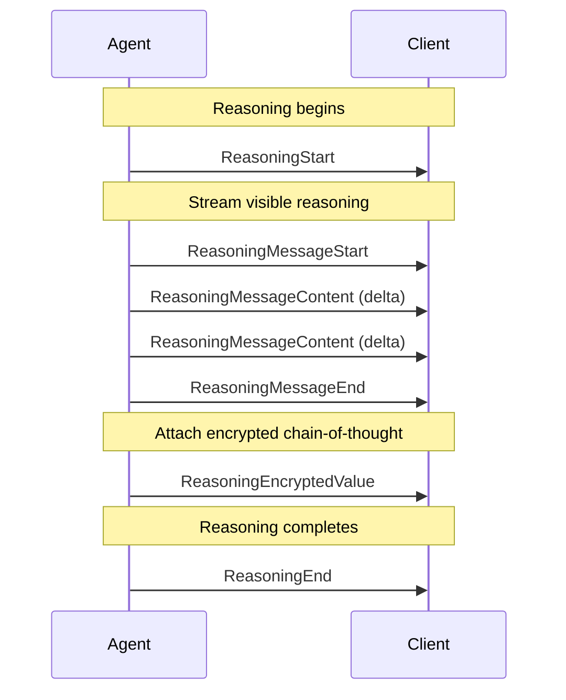

# 推理（reasoning）

AG-UI 为 LLM 推理（reasoning）提供一等支持，既能实现思维链的可见性，又能在跨对话轮次时保持隐私与状态（state）连续性。

## 概述

现代 LLM 越来越多地使用思维链推理（reasoning）来提升响应质量。AG-UI 的推理（reasoning）支持应对三个关键挑战：

- **推理（reasoning）可见性**：向用户呈现推理（reasoning）信号（例如摘要），而不暴露原始思维链
- **状态（state）连续性**：使用加密推理（reasoning）条目在轮次之间维持推理（reasoning）上下文，即使在 `store:false` 或零数据保留（ZDR）策略下也是如此
- **隐私合规**：在保留推理（reasoning）能力（capability）的同时满足企业隐私要求

> [!TIP]
> 与活动（activity）消息（message）不同，推理（reasoning）消息（message）旨在表示 Agent 的内部思考过程，并且可能出于隐私目的而被加密，其设计意图是在后续轮次中发送回 Agent 以进一步处理。

## ReasoningMessage

`ReasoningMessage` 类型表示消息（message）历史中的推理（reasoning）内容：

```typescript
interface ReasoningMessage {
  id: string
  role: "reasoning"
  content: string // 推理内容（对客户端可见）
  encryptedValue?: string // 可选的加密推理，用于保持状态连续性
}
```

| 属性             | 类型          | 说明                                                 |
| ---------------- | ------------- | ---------------------------------------------------- |
| `id`             | `string`      | 推理（reasoning）消息（message）的唯一标识符                                 |
| `role`           | `"reasoning"` | 消息（message）角色判别字段                                     |
| `content`        | `string`      | 对客户端（client）可见的推理（reasoning）内容                               |
| `encryptedValue` | `string?`     | 用于保持状态（state）连续性的加密思维链数据块                 |

关键特性：

- **与助手消息（message）分离**：推理（reasoning）与最终响应保持相互独立，避免污染对话历史
- **可流式传输（transport）**：内容通过流式事件（event）到达
- **可选加密**：当存在 `encryptedValue` 时，它表示加密的思维链，由客户端（client）以不透明的方式存储并转发

## 推理（reasoning）事件（event）

推理（reasoning）事件（event）负责管理推理（reasoning）消息（message）的生命周期。完整的事件（event）参考请参见[事件（event）](events.md#推理reasoning事件event)。

### 事件（event）流

典型的推理（reasoning）流程遵循以下模式：



### 事件（event）类型

| 事件（event）                      | 用途                                                           |
| ------------------------- | -------------------------------------------------------------- |
| `ReasoningStart`          | 标记推理（reasoning）阶段的开始                                             |
| `ReasoningMessageStart`   | 开始一条流式推理（reasoning）消息（message）                                           |
| `ReasoningMessageContent` | 投递推理（reasoning）内容的分片                                             |
| `ReasoningMessageEnd`     | 完成一条推理（reasoning）消息（message）                                               |
| `ReasoningMessageChunk`   | 便捷事件（event），自动管理消息（message）生命周期                                 |
| `ReasoningEnd`            | 标记推理（reasoning）的完成                                                 |
| `ReasoningEncryptedValue` | 将加密思维链附加到某条消息（message）或某个工具调用（tool call）上                     |

## 隐私与合规

AG-UI 的推理（reasoning）功能以隐私优先为设计原则：

### 零数据保留（ZDR）

对于要求零数据保留的部署场景：

1. **加密推理（reasoning）值**可以在各轮次之间传递状态（state），而无需在客户端（client）存储可解密的内容
2. 客户端（client）通过 `ReasoningEncryptedValue` 事件（event）以不透明的方式接收并转发 `encryptedValue` 数据块
3. 只有 Agent（或被授权的后端）才能解密推理（reasoning）内容

### 可见性控制

Agent 负责控制哪些推理（reasoning）对用户可见：

- **完全可见**：通过 `ReasoningMessageContent` 事件（event）流式输出完整的思维链
- **仅摘要**：输出精简的摘要，同时将详细推理（reasoning）作为加密值（encrypted value）附加
- **隐藏**：只使用 `ReasoningEncryptedValue` 事件（event），不做任何可见的流式输出

### 合规考量

| 要求                    | 解决方案                                                                            |
| ----------------------- | ----------------------------------------------------------------------------------- |
| GDPR 删除权             | 加密内容可以被丢弃，而不会丧失推理（reasoning）能力（capability）                                              |
| SOC 2 数据处理          | 推理（reasoning）内容从不在客户端（client）以明文形式存储                                                  |
| HIPAA 最小必要原则      | 只暴露摘要；详细推理（reasoning）保持加密状态（state）                                                    |
| 审计日志                | `ReasoningStart`/`ReasoningEnd` 事件（event）提供审计线索，同时不暴露内容                    |

## 示例实现

### 基础推理（reasoning）流程

一个展示可见推理（reasoning）的简单实现：

```typescript
// Agent 发出推理（reasoning）开始事件（event）
yield {
  type: "REASONING_START",
  messageId: "reasoning-001",
}

// 流式输出可见的推理（reasoning）内容
yield {
  type: "REASONING_MESSAGE_START",
  messageId: "msg-123",
  role: "reasoning",
}

yield {
  type: "REASONING_MESSAGE_CONTENT",
  messageId: "msg-123",
  delta: "Let me ",
}

yield {
  type: "REASONING_MESSAGE_CONTENT",
  messageId: "msg-123",
  delta: "think through ",
}

yield {
  type: "REASONING_MESSAGE_CONTENT",
  messageId: "msg-123",
  delta: "this step ",
}

yield {
  type: "REASONING_MESSAGE_CONTENT",
  messageId: "msg-123",
  delta: "by step...",
}

yield {
  type: "REASONING_MESSAGE_END",
  messageId: "msg-123",
}

// 结束推理（reasoning）
yield {
  type: "REASONING_END",
  messageId: "reasoning-001",
}
```

### 用于保持状态（state）连续性的加密内容

若要在轮次之间维持推理（reasoning）状态（state）而不暴露内容，可使用 `ReasoningEncryptedValue` 事件（event）将加密思维链附加到消息（message）或工具调用（tool call）上：

```typescript
// Agent 发出推理（reasoning）开始事件（event）
yield {
  type: "REASONING_START",
  messageId: "reasoning-002",
}

// 为用户流式输出一段可见摘要
yield {
  type: "REASONING_MESSAGE_START",
  messageId: "msg-456",
  role: "reasoning",
}

yield {
  type: "REASONING_MESSAGE_CONTENT",
  messageId: "msg-456",
  delta: "Analyzing your request...",
}

yield {
  type: "REASONING_MESSAGE_END",
  messageId: "msg-456",
}

// 将加密思维链附加到该推理（reasoning）消息（message）上
yield {
  type: "REASONING_ENCRYPTED_VALUE",
  subtype: "message",
  entityId: "msg-456",
  encryptedValue: "eyJhbGciOiJBMjU2R0NNIiwiZW5jIjoiQTI1NkdDTSJ9...",
}

yield {
  type: "REASONING_END",
  messageId: "reasoning-002",
}

// 在后续轮次中，客户端（client）会把带有 encryptedValue 的消息（message）发回，
// Agent 可以解密它以恢复推理（reasoning）上下文
```

### 将加密推理（reasoning）附加到工具调用（tool call）

你还可以将加密推理（reasoning）附加到工具调用（tool call）上，以记录 Agent 为何选择特定参数，或它如何解释工具结果（tool result）：

```typescript
// 带有加密推理（reasoning）的工具调用（tool call）
yield {
  type: "TOOL_CALL_START",
  toolCallId: "tool-123",
  toolCallName: "search_database",
  parentMessageId: "msg-789",
}

yield {
  type: "TOOL_CALL_ARGS",
  toolCallId: "tool-123",
  delta: '{"query": "user preferences"}',
}

yield {
  type: "TOOL_CALL_END",
  toolCallId: "tool-123",
}

// 附加加密推理（reasoning），说明为何调用该工具
yield {
  type: "REASONING_ENCRYPTED_VALUE",
  subtype: "tool-call",
  entityId: "tool-123",
  encryptedValue: "encrypted-reasoning-about-tool-selection...",
}
```

### 符合 ZDR 的实现

对于零数据保留场景：

```typescript
// 服务端（server）：发送前先加密推理（reasoning）内容
const encryptedReasoning = await encrypt(detailedChainOfThought, secretKey)

yield {
  type: "REASONING_START",
  messageId: "reasoning-003",
}

// 只向客户端（client）发送高层级摘要
yield {
  type: "REASONING_MESSAGE_CHUNK",
  messageId: "summary-001",
  delta: "Processing your request securely...",
}

yield {
  type: "REASONING_MESSAGE_CHUNK",
  messageId: "summary-001",
  delta: "", // 空的 delta 会关闭该消息
}

// 附加加密的思维链
yield {
  type: "REASONING_ENCRYPTED_VALUE",
  subtype: "message",
  entityId: "summary-001",
  encryptedValue: encryptedReasoning,
}

yield {
  type: "REASONING_END",
  messageId: "reasoning-003",
}

// 客户端（client）只存储：
// - 加密数据块（无法解密）
// - 摘要文本（不含敏感细节）
// 完整推理（reasoning）绝不会以明文形式被持久化
```

### 使用便捷的 Chunk 事件（event）

`ReasoningMessageChunk` 事件（event）通过自动管理消息（message）生命周期来简化实现：

```typescript
// 带有 messageId 的第一个分片会自动开启消息（message）
yield {
  type: "REASONING_MESSAGE_CHUNK",
  messageId: "msg-789",
  delta: "Analyzing the problem space...",
}

// 后续分片继续该流
yield {
  type: "REASONING_MESSAGE_CHUNK",
  messageId: "msg-789",
  delta: " Considering multiple approaches...",
}

// 空的 delta（或下一个非推理（reasoning）事件（event））会自动关闭消息（message）
yield {
  type: "REASONING_MESSAGE_CHUNK",
  messageId: "msg-789",
  delta: "",
}
```

## 客户端（client）集成

### 处理推理（reasoning）事件（event）

```typescript
import { EventType, type BaseEvent } from "@ag-ui/core"

function handleEvent(event: BaseEvent) {
  switch (event.type) {
    case EventType.REASONING_START:
      // 初始化推理（reasoning）界面（例如"思考中"指示器）
      console.log("Agent is reasoning...")
      break

    case EventType.REASONING_MESSAGE_CONTENT:
      // 将可见推理（reasoning）追加到界面
      appendReasoningText(event.messageId, event.delta)
      break

    case EventType.REASONING_ENCRYPTED_VALUE:
      // 为所引用的实体存储加密值（encrypted value）
      if (event.subtype === "message") {
        storeMessageEncryptedValue(event.entityId, event.encryptedValue)
      } else if (event.subtype === "tool-call") {
        storeToolCallEncryptedValue(event.entityId, event.encryptedValue)
      }
      break

    case EventType.REASONING_END:
      // 结束推理（reasoning）界面
      console.log("Reasoning complete")
      break
  }
}
```

### 回传加密推理（reasoning）

在发起后续请求时，请带上已存储的加密值（encrypted value）：

```typescript
const response = await agent.run({
  threadId: "thread-123",
  messages: [
    ...previousMessages,
    {
      id: "reasoning-002",
      role: "reasoning",
      content: "Analyzing your request...", // 可见摘要
      encryptedValue: storedEncryptedBlob, // 对客户端不透明
    },
    {
      id: "user-msg-001",
      role: "user",
      content: "Follow up question...",
    },
  ],
})
```

## 从 Thinking 事件（event）迁移

> [!WARNING]
> `THINKING_*` 事件（event）已被废弃，并将在 1.0.0 版本中移除。新的实现应使用
> `REASONING_*` 事件（event）。

### 已废弃的事件（event）

以下事件（event）已被废弃：

| 已废弃事件（event）                      | 替代事件（event）                    |
| ------------------------------- | --------------------------- |
| `THINKING_START`                | `REASONING_START`           |
| `THINKING_END`                  | `REASONING_END`             |
| `THINKING_TEXT_MESSAGE_START`   | `REASONING_MESSAGE_START`   |
| `THINKING_TEXT_MESSAGE_CONTENT` | `REASONING_MESSAGE_CONTENT` |
| `THINKING_TEXT_MESSAGE_END`     | `REASONING_MESSAGE_END`     |

### 迁移步骤（step）

1. **更新事件（event）类型**：将所有 `THINKING_*` 事件（event）类型替换为对应的 `REASONING_*` 事件（event）类型
2. **更新消息（message）类型**：使用带 `role: "reasoning"` 的 `ReasoningMessage`，而不是任何 thinking 专用的消息（message）类型
3. **增加加密值（encrypted value）支持**：考虑使用 `ReasoningEncryptedValue` 事件（event）以提升隐私合规性
4. **充分测试**：确保现有功能在新的事件（event）类型下正常工作

### 迁移示例

改造前（已废弃）：

```typescript
// ❌ 已废弃 - 请勿使用
yield { type: "THINKING_START", messageId: "think-001" }
yield { type: "THINKING_TEXT_MESSAGE_START", messageId: "msg-001" }
yield { type: "THINKING_TEXT_MESSAGE_CONTENT", messageId: "msg-001", delta: "..." }
yield { type: "THINKING_TEXT_MESSAGE_END", messageId: "msg-001" }
yield { type: "THINKING_END", messageId: "think-001" }
```

改造后（当前写法）：

```typescript
// ✅ 当前实现
yield { type: "REASONING_START", messageId: "reasoning-001" }
yield { type: "REASONING_MESSAGE_START", messageId: "msg-001", role: "assistant" }
yield { type: "REASONING_MESSAGE_CONTENT", messageId: "msg-001", delta: "..." }
yield { type: "REASONING_MESSAGE_END", messageId: "msg-001" }
yield { type: "REASONING_END", messageId: "reasoning-001" }
```

## 最佳实践

1. **始终成对使用开始/结束事件（event）**：每个 `ReasoningStart` 都应有对应的
   `ReasoningEnd`
2. **对敏感推理（reasoning）使用加密值（encrypted value）**：当思维链包含敏感信息时，使用
   `ReasoningEncryptedValue` 将加密内容附加到消息（message）或工具调用（tool call）上
3. **提供用户反馈**：即使推理（reasoning）被加密，也应输出可见摘要，让用户知道 Agent 正在工作
4. **优雅地处理缺失事件（event）**：客户端（client）应能容忍不完整的事件（event）流
5. **考虑带宽**：对于非常长的推理（reasoning）链，可考虑只输出摘要以减少数据传输（transport）

## 相关文档

- [事件（event）](events.md#推理reasoning事件event) - 完整的事件（event）类型参考
- [消息（message）](messages.md#推理reasoning消息message) - 消息（message）类型文档
- [序列化（serialization）](serialization.md) - 状态（state）连续性与血缘
