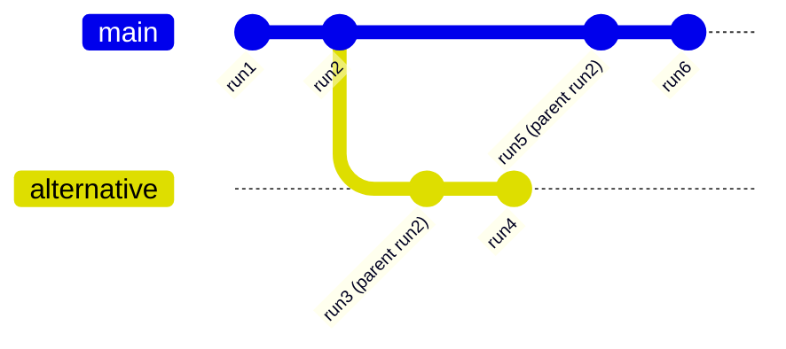

# 序列化（serialization）

AG-UI 中的序列化（serialization）提供了一种标准方式，用来持久化并恢复驱动 Agent–UI 会话的事件（event）流。借助一个已序列化（serialized）的流，你可以：

- 在重新加载或重连后恢复聊天历史与 UI 状态（state）
- 挂接到正在运行（running）的 Agent 并继续接收事件（event）
- 从任意先前的运行（run）创建分支（branch）（时间旅行）
- 压缩（compact）已存储的历史以减小体积而不丢失语义

本页说明该模型、更新后的事件（event）字段，以及带示例的实用模式。

## 核心概念

- 流序列化（serialization） – 把完整的事件（event）历史与一种可移植的表示（例如 JSON）互相转换，以便存入数据库、文件或日志。
- 事件（event）压缩（compaction） – 在保持语义的前提下把冗长的流缩减为快照（snapshot）（例如合并内容块、把增量（delta）折叠为快照（snapshot））。
- 运行（run）谱系 – 用 `parentRunId` 追踪对话的分支（branch），形成类似 git 的仅追加日志，从而支持时间旅行与备选路径。

## 更新后的事件（event）字段

`RunStarted` 事件（event）包含额外的可选字段：

```ts
type RunStartedEvent = BaseEvent & {
  type: EventType.RUN_STARTED
  threadId: string
  runId: string
  /** 同一线程（thread）内用于分支化/时间旅行的父级 */
  parentRunId?: string
  /** 本次运行（run）确切的 Agent 输入（可以省略历史中已有的消息（message）） */
  input?: AgentInput
}
```

这些字段支持谱系追踪，并让实现能够精确记录传给 Agent 的内容，独立于先前已记录的消息（message）。

## 事件（event）压缩（compaction）

压缩（compaction）在保持相同可观测结果的前提下减少事件（event）流中的噪声。典型实现会提供一个工具函数：

```ts
declare function compactEvents(events: BaseEvent[]): BaseEvent[]
```

常见的压缩（compaction）规则包括：

- 消息（message）流 – 把 `TEXT_MESSAGE_*` 序列合并为单条消息快照（message snapshot）；把同一条消息（message）相邻的 `TEXT_MESSAGE_CONTENT` 拼接起来。
- 推理（reasoning）流 – 以同样方式拼接同一条推理（reasoning）消息（message）的 `REASONING_MESSAGE_CONTENT`。
- 工具调用（tool call） – 把工具调用（tool call）的 start/content/end 折叠为一条紧凑记录。
- 状态（state） – 把连续的 `STATE_DELTA` 事件（event）合并为单个最终的 `STATE_SNAPSHOT`，并丢弃被取代的更新。
- 运行（run）输入规范化 – 从 `RunStarted.input.messages` 中移除流中更早位置已存在的任何消息（message）。

## 分支化（branching）与时间旅行

在 `RunStarted` 事件（event）上设置 `parentRunId` 会创建类似 git 的谱系。该流成为一份不可变的仅追加日志，其中每次运行（run）都可以从任意先前的运行（run）分支（branch）出来。



优点：

- 同一份已序列化（serialized）日志中可以有多条分支（branch）
- 不可变的历史（仅追加）
- 可确定地时间旅行到任意时点

## 示例

### 基础序列化（serialization）

```ts
// 序列化（serialization）事件（event）流
const events: BaseEvent[] = [...];
const serialized = JSON.stringify(events);

await storage.save(threadId, serialized);

// 之后恢复并压缩（compact）
const restored = JSON.parse(await storage.load(threadId));
const compacted = compactEvents(restored);
```

### 事件（event）压缩（compaction）

之前：

```ts
[
  { type: "TEXT_MESSAGE_START", messageId: "msg1", role: "user" },
  { type: "TEXT_MESSAGE_CONTENT", messageId: "msg1", delta: "Hello " },
  { type: "TEXT_MESSAGE_CONTENT", messageId: "msg1", delta: "world" },
  { type: "TEXT_MESSAGE_END", messageId: "msg1" },
  { type: "STATE_DELTA", patch: { op: "add", path: "/foo", value: 1 } },
  { type: "STATE_DELTA", patch: { op: "replace", path: "/foo", value: 2 } },
]
```

之后：

```ts
[
  {
    type: "MESSAGES_SNAPSHOT",
    messages: [{ id: "msg1", role: "user", content: "Hello world" }],
  },
  {
    type: "STATE_SNAPSHOT",
    state: { foo: 2 },
  },
]
```

### 用 `parentRunId` 分支化（branching）

```ts
// 原始运行（run）
{
  type: "RUN_STARTED",
  threadId: "thread1",
  runId: "run1",
  input: { messages: ["Tell me about Paris"] },
}

// 从 run1 分支
{
  type: "RUN_STARTED",
  threadId: "thread1",
  runId: "run2",
  parentRunId: "run1",
  input: { messages: ["Actually, tell me about London instead"] },
}
```

### 规范化输入

```ts
// 第一次运行（run）包含完整消息（message）
{
  type: "RUN_STARTED",
  runId: "run1",
  input: { messages: [{ id: "msg1", role: "user", content: "Hello" }] },
}

// 第二次运行（run）省略已存在的消息（message）
{
  type: "RUN_STARTED",
  runId: "run2",
  input: { messages: [{ id: "msg2", role: "user", content: "How are you?" }] },
  // msg1 被省略；它已存在于历史中
}
```

## 元数据（metadata）

事件（event）与消息（message）都携带一个可选的 [`metadata`](metadata.md) 对象，它也是你正在序列化（serialization）的内容之一——请把它和其他一切一同持久化，否则重放出来的流会缺失 token 用量、trace id 以及生产者（producer）附加的其他任何内容。

持久化时要知道两件事：

- **压缩（compaction）会把它折叠进去。** 折叠增量（delta）时会合并它们的元数据（metadata），后写覆盖先写。关于顺序方面的注意事项，见[事件（event）压缩（compaction）](#事件event压缩compaction)与[压缩（compaction）参考](https://docs.ag-ui.com/sdk/js/client/compaction)。
- **二进制（binary）比 JSON 更窄。** 在 protobuf 之上，元数据（metadata）是 `google.protobuf.Struct`，因此 null、数组与嵌套对象都能保留——但数字是 IEEE-754 double，所以超出 2^53 的整数会丢失精度，而且若干事件（event）类型完全没有 protobuf 表示。JSON 则能把一切精确往返。归档存储请优先使用 JSON。

## 实现说明

- 为压缩（compaction）与（反）序列化（serialization）提供 SDK 辅助工具。
- 以仅追加方式存储流；尽可能采用增量（delta）写入。
- 持久化长历史时考虑压缩（compression）。
- 按 `threadId`、`runId` 与时间戳建立索引以便快速检索。

## 另见

- 概念：[事件（event）](events.md)、[元数据（metadata）](metadata.md)、
  [状态（state）管理](state.md)
- SDK：TypeScript 编码器与核心事件（event）类型
