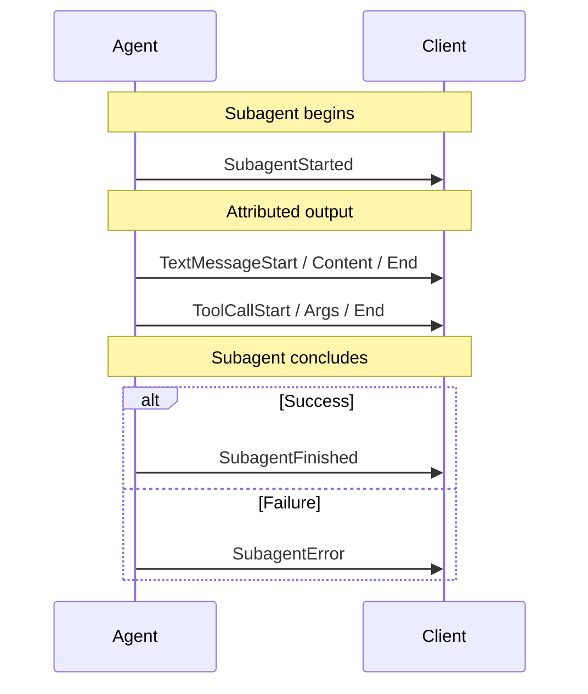

# 子 Agent（subagent）

许多 Agent 框架允许一个 Agent 把工作委派给子 Agent（subagent）——例如主管派发研究任务、工具即 Agent 模式中一次工具调用（tool call）*本身*就是一个嵌套 Agent，或规划器并行分派子任务。

对前端（frontend）而言，这一切都以单一事件（event）流的形式到达。若没有额外信息，就无法判断某条消息（message）是由哪个子 Agent 产生的，于是三个并发的研究者会被渲染成一堵毫无区分的文字墙。

AG-UI 的子 Agent 支持恰好解决这一问题，且仅止于此：它把每个事件**归属**到产生它的子 Agent，并报告子 Agent 何时开始与结束。它不编排、不调度、也不定义子 Agent——这些完全由框架负责。

## `subagentRunId` 标识的是一次调用，而不是一个定义

这是最需要理解、也最容易搞错的一点。

`subagentRunId` 是某个子 Agent **单次调用的不透明句柄**。同一个子 Agent 运行（run）两次，就会得到两个不同的值。它不是可复用子 Agent 定义的稳定标识符，也不是一个名称。

与顶层运行的对称性能让这一区分更清晰：

| 顶层                            | 子 Agent                                       |
| ------------------------------------ | ---------------------------------------------- |
| `agentId` —— 一个已配置、可复用的 Agent | 子 Agent 的 `name` —— 一个可复用的子 Agent 类型 |
| `runId` —— 一次调用的生命周期 | `subagentRunId` —— 一次嵌套调用的生命周期 |

因此：

- **应当**用 `subagentRunId` 作为瞬态 UI 状态（state）的键——例如可折叠分组、加载指示器、进度行。
- **不要**以 `subagentRunId` 为键持久化任何内容，并指望它在后续运行中仍有意义；也不要把同一个子 Agent 的两次调用视为共享同一个值。当你表达的是“这是哪一类子 Agent”时，请使用 `name`。
- **一个例外**：以 `outcome: { type: "suspended" }` 结束的子 Agent **可以**在恢复（resume）运行时复用其 id。能够把恢复后的工作与被挂起的调用关联起来的生产者（producer）应当这样做，而客户端（client）必须把后来那个 `SubagentStarted` 视为续接（等待中 → 运行中），绝不能视为重复。无法关联的生产者会铸造新的 id——此时客户端的等待状态通过它所应答的中断（interrupt）id 来消解，而不是通过 id 复用（参见[挂起](#挂起)）。

> [!NOTE]
> 该字段在预发布构建中称为 `subagentId`。它被重命名，是因为旧名称暗示了一个可复用的定义。如果你使用的是仍在使用 `subagentId` 的 `canary` 构建，其取值含义相同——只是名称变了。

## 生命周期事件（event）

三个事件包住了一个子 Agent 的活动（activity）区间。



### SubagentStarted

宣告一个新的子 Agent 调用，并给出一个可供 UI 显示的名称。

| 属性              | 说明                                                     |
| --------------------- | --------------------------------------------------------------- |
| `subagentRunId`       | 本次调用的不透明 id。必填                          |
| `name`                | 子 Agent 声明的类型或名称，用于显示。必填      |
| `description`         | 可选的人类可读描述                             |
| `parentSubagentRunId` | 可选——子 Agent 嵌套时，指外层子 Agent           |
| `parentToolCallId`    | 可选——催生出该子 Agent 的工具调用              |
| `parentMessageId`     | 可选——承载该工具调用的消息                  |

`parentToolCallId` 与 `parentMessageId` 是为工具即 Agent 模式而存在的。它们让客户端能把子 Agent 与创建它的那次调用关联起来——例如在工具调用卡片内部渲染该子 Agent 的输出——而无需检查 `rawEvent`。

### SubagentFinished

关闭某个子 Agent 调用在本次运行中的事件流片段。

| 属性        | 说明                                             |
| --------------- | ------------------------------------------------------- |
| `subagentRunId` | 与 `SubagentStarted` 中的 id 一致。必填          |
| `result`        | 可选的完成载荷，对应 `RunFinished.result` |
| `outcome`       | 可选的有类型结果，对应 `RunFinished.outcome`：`{ type: "success" }` 或 `{ type: "suspended", interruptIds?: [...] }`。省略即表示成功 |

#### 挂起

子 Agent 可以在任务中途暂停，等待外部输入——比如在其中提出的一项人类审批。此时运行会以中断结果结束（参见[中断](interrupts.md)），而由于每个已启动的子 Agent 都必须在 `RunFinished` 之前关闭，被暂停的子 Agent 仍会发出 `SubagentFinished`——但携带 `outcome: { type: "suspended" }`，以便 UI 渲染“等待中”而不是“已完成”。`interruptIds` 列出该子 Agent 直接拥有的运行级中断（每个此类 `Interrupt` 也携带指回它的 `subagentRunId`）；对于因*后代*发生中断而被挂起的祖先，该字段可以为空或省略。

挂起是 `subagentRunId` 唯一可能刻意跨运行使用的情形——两侧的义务各不相同：

- **客户端必须接受**后续运行中复用某个被挂起调用 id 的 `SubagentStarted`，并将其视为*续接*——把已有的分组从等待中切回运行中，绝不能渲染出重复项。
- **生产者应当在能够**把恢复后的工作与被挂起的调用关联起来时复用该 id。LangGraph 集成就是这样做的：它的 id 派生自检查点任务的标识，该标识能在暂停后存活。正是复用让客户端能够无缝延续该分组。
- **无法关联的生产者会铸造新的 id**，这也是合法的。客户端的等待状态不会悬空：挂起结果的 `interruptIds` 以及客户端自己发出的恢复条目已经指明了哪些审批得到了应答，因此即便旧 id 下没有续接到来，等待标记也能据此消解。

### SubagentError

将某个子 Agent 调用标记为失败。

| 属性        | 说明                                    |
| --------------- | ---------------------------------------------- |
| `subagentRunId` | 与 `SubagentStarted` 中的 id 一致。必填 |
| `message`       | 人类可读的错误消息。必填         |
| `code`          | 可选的错误码                            |

## 归属

除生命周期事件之外，大多数事件都可以携带一个可选的 `subagentRunId`，用以说明它们由谁产生。

不带 `subagentRunId` 的事件归属于父 Agent。归属是增量（delta）式的：从不设置该字段的事件流，其行为与子 Agent 功能出现之前完全一致。

归属信息也可以独立存在。生产者可以只给事件打标签，而从不发出 `SubagentStarted` / `SubagentFinished`——这足以让 UI 按生产者对输出分组，而无需承诺上报生命周期。客户端必须接受从未见过其宣告的标识符；参见[客户端强制执行的规则](#客户端 client 强制执行的规则)。

**可以携带归属信息的事件：**文本消息族、工具调用族、活动事件、推理（reasoning）族、步骤事件、状态事件，以及 `Raw`/`Custom`。

**不能携带归属信息的事件：**`RunStarted`、`RunFinished`、`RunError`——它们描述的是整个运行——以及 `MessagesSnapshot`，后者改为逐条消息携带归属信息，因为一份快照（snapshot）会混合来自多个生产者的消息。

### 归属是来源信息，而非所有权

这一区分在状态事件上最为重要，因此值得明确说明。

`StateSnapshot` 与 `StateDelta` 都可以携带归属信息。它们上面的归属记录的是**哪个子 Agent 产生了这次更新**——并不意味着该子 Agent 拥有自己的状态。AG-UI 的状态是运行作用域的：一次运行只有一份状态文档，带归属的快照或增量仍然作用于这一份文档。该标签是可以呈现给用户的来源信息（例如“研究者更新了共享草稿板”），而不是一个独立的作用域。

这正是归属信息在其他独立事件上所承载的全部含义。没有人会把一个带归属的 `Custom` 事件读作该子 Agent 拥有私有的自定义事件，状态亦是如此。

> [!WARNING]
> 不存在按子 Agent 划分的状态。如果你给一个快照打上归属，并期望父 Agent 的状态保持不变，那不会发生——该快照会像任何快照一样替换运行的状态。若你需要把各子 Agent 的数据区分开，请在运行状态内部使用不同的 key。

请注意，生产者从不被*强制*要求为状态添加归属。有些生产者并不这样做：例如 LangGraph 集成在子 Agent 活动期间不发出状态，因为它的状态是一份共享文档，而委派中途的快照会带有局部视图。这是一种合理的生产者侧选择，并非协议要求。

### 归属信息会转移到消息（message）上

当某个带归属的事件创建了一条消息时，`subagentRunId` 会转移到该消息上。这正是渲染层能够按子 Agent 对会话分组、而无需重放事件流的原因——消息自身携带了其来源，并在多轮对话与快照之间保持不变。

### 工具结果（tool result）携带自己的归属

`ToolCallResult` 的归属独立于它所应答的那次调用，这是刻意设计而非疏漏：*执行*某次工具调用的一方可能与*请求*它的子 Agent 不同。由前端执行的工具，或由主管代某个子 Agent 运行的调用，二者产生的结果其归属者都不是调用方。若继承调用方的归属，就会错误地报告这些情形，因此每个结果各自声明自己的归属。

## 嵌套与并发

子 Agent 可以嵌套。`SubagentStarted` 上的 `parentSubagentRunId` 把子级链接到其外层子 Agent；没有父级链接的子 Agent 直接归属于该次运行。

子 Agent 还会**并发**运行，而正是这种情形区分出真正可用的实现与看似合理的实现。当三个子 Agent 同时流式输出时，它们的事件相互交织，而归属信息是唯一能够区分它们的手段。具体来说：

- 两个子 Agent 可能同时拥有未关闭的文本消息。客户端必须分别独立跟踪，而不是假定同一时刻只有一条未关闭的消息。
- 某个子 Agent 的 `SubagentFinished` 只关闭该子 Agent 自己的未关闭流，绝不关闭兄弟节点或父级的流。
- 父级可能先于其子级结束。因此 `parentSubagentRunId` 可能指向一个已经结束的子 Agent，这是合法的。

### 并发与 chunk 简写

`TextMessageChunk` / `ToolCallChunk` / `ReasoningMessageChunk` 事件是一种简写：客户端会自行合成 START/CONTENT/END 边界，而省略 id 的 chunk 表示“与上一个相同”。在并发情形下，“上一个”只在**每个子 Agent 内部**才有意义——因此该简写是在发送方子 Agent 自己的流内部解析的，而不是跨整个运行解析。

实际后果对生产者来说就是一条规则：既没有 id 也没有 `subagentRunId` 的 chunk，若父级存在该类型的未关闭流，就解析到父级的流上——无标签即意味着父级——否则解析到该类型唯一的未关闭流上。当多个子 Agent 的流都可能声称拥有它时，就无从解析，客户端会拒绝它而不是猜测。**并发流式输出时，请为每个 chunk 加上归属**，或者重复 id。

## 客户端（client）强制执行的规则

以下每条规则都*以相应事件存在为前提*。仅使用归属信息本身就是对子 Agent 支持的一种完整、合法的用法，因此这里没有任何一条要求事件流必须发送生命周期事件。

- `SubagentFinished` 与 `SubagentError` 所指名的子 Agent 必须当前处于活动状态，且同一个子 Agent 在一次运行中不会被启动两次。生命周期事件携带其 schema 要求的字段（三者都有 `subagentRunId`，`SubagentStarted` 有 `name`，`SubagentError` 有 `message`）——即便是绕过线路级 schema 校验的进程内生产者，客户端也会强制执行这一点。
- 续接与关闭事件必须与其所属实体创建时所记录的归属者一致。由某个子 Agent 打开的文本消息，不能被另一个子 Agent 继续。
- 归属关系也会由重放的历史确立：`MessagesSnapshot` 中的一条消息（以及它携带的每个工具调用）归属于它所携带的 `subagentRunId`——缺席即表示父级——而后续事件若以不同的归属者重新打开该 id，会被拒绝，正如冲突的第二个打开者会被拒绝一样。
- 工具调用归属于其 `parentMessageId` 所指名的助手消息。`ToolCall` 本身不携带归属字段，因此如果一个 `ToolCallStart` 显式的 `subagentRunId` 与该消息的归属者不一致，就无法被忠实表示，会被拒绝；未打标签的工具调用则继承父消息的归属者。
- 步骤的作用域限于打开它的 Agent：子 Agent 不能关闭父级的步骤，也不能关闭兄弟的步骤。
- 每个已启动的子 Agent 都必须在 `RunFinished` 之前关闭。

有几件事是刻意**不**强制执行的，因为协议并不要求它们：

- **用于归属的 `subagentRunId` 不必是已启动的。** 不带生命周期事件的归属是一种受支持的模式，因此客户端不得把未宣告的标识符当作错误。UI 应按照它看到的任何 id 进行分组，并在没有 `name` 时回退显示该 id。
- `parentSubagentRunId` 只需指名一个已被*启动*的子 Agent，而不必是仍在活动的子 Agent——父级先于子级结束是合理的。
- 归属于已结束子 Agent 的事件会被接受。续接事件即便在子 Agent 结束后，仍携带它所属子 Agent 的标签。
- 关闭只要求在 `RunFinished` 之前完成，不要求在 `RunError` 之前完成。未关闭的子 Agent 正是一次被中止的运行所应有的形态。
- 带归属的状态事件会被接受。生产者选择在委派中途不发出它们，属于生产者侧的决策，而不是规则——参见[归属是来源信息，而非所有权](#归属是来源信息而非所有权)。

## 兼容性

> [!WARNING]
> **较旧的客户端会直接拒绝这些生命周期事件。** 归属信息是增量且安全的——`subagentRunId` 是一个未知的*字段*，客户端可以容忍——但 `SubagentStarted`、`SubagentFinished` 与 `SubagentError` 是未知的*事件类型*，早于子 Agent 支持的客户端在解码阶段、任何应用代码运行之前就会因它们而失败。客户端侧无法把它们过滤掉。
>
> 若你的部分消费者（consumer）早于子 Agent 支持，生产者不得向它们发出这些生命周期事件。

两个方向并不对称，因此值得分开讨论。

### 新 Agent 与旧客户端（client）通信

生命周期事件会破坏这种组合，因此发出它们必须**在生产者侧按需主动开启**。支持子 Agent 的集成因此提供了一个启用它们的标志，默认关闭——在 LangGraph 集成中该标志为 `subagent_visibility`：

```python
agent = LangGraphAgent(
    name="my-agent",
    graph=graph,
    subagent_visibility="attributed",
)
```

该取值命名了客户端所看到的内容。`"inline"`（默认值）不发出任何生命周期事件，也不发出 `subagentRunId`，并且没有任何与子 Agent 相关的内容进入 `MessagesSnapshot`——事件流与子 Agent 支持出现之前完全一样，包括子 Agent 自己的文本也作为父级的工作到达。`"attributed"` 发出本文档所述的完整表面。`"hidden"` 完全抑制子 Agent 的内部流：客户端只看到父级催生该子 Agent 的工具调用、它的结果，以及父级自己的回复。一旦所有消费者都足够新，就打开 `"attributed"`。

仅使用归属信息是更安全的中间步骤，因为不认识该字段的客户端会忽略它。希望获得分组效果又不想破坏兼容性的生产者，可以只给事件加归属，而完全跳过生命周期。

### 新客户端（client）与旧 Agent 通信

自动处理。TypeScript 客户端会依据 Agent 上报的版本插入一层兼容垫片，并在**两个**方向上都生效。

- **客户端 → Agent。** 该垫片会从外发的输入消息中剥离 `subagentRunId`，因此较旧的 Agent 永远不会收到它无法解释的归属信息。这是承担主要作用的一半：被重放的消息历史，或由较新客户端写入的已存储线程（thread），确实可能携带该字段。
- **Agent → 客户端。** 该垫片还会丢弃 `SubagentStarted`、`SubagentFinished` 与 `SubagentError`，并从其余每个事件中剥离 `subagentRunId`（包括 `MessagesSnapshot` 中的消息以及 `RunStarted` 的输入回显）。这是防御性归一化，而非转换——一个上报子 Agent 之前版本的 Agent 本就不应发出上述任何内容，因此它真正防范的是混合部署或经过代理的管道。

第二个方向的后果值得了解：位于该垫片之后的消费者看到的是一条**扁平化、不带归属的事件流**，即便上游确实添加了归属。若你希望归属信息到达你的 UI，Agent 必须上报一个支持子 Agent 的版本。

## 支持情况

| SDK        | 状态                                                       |
| ---------- | ------------------------------------------------------------ |
| TypeScript | 事件、归属、校验、订阅者钩子、protobuf |
| Python     | 事件与归属                                       |
| .NET       | 事件、归属、校验、protobuf                  |

二进制 protobuf 传输（transport）在 TypeScript 与 .NET 上都携带子 Agent 归属信息，且由同一份 schema 生成，因此一条带子 Agent 归属的事件流可以跨语言完成往返。

### 已知限制

- **Protobuf 只覆盖事件类型的一个子集。** 36 种事件类型中有 19 种具有 protobuf 映射：全部三种子 Agent 事件，以及文本消息、工具调用 start/args/end、状态、步骤与运行各族，外加 `MessagesSnapshot`、`Raw` 与 `Custom`。其余类型根本无法编码——而其中有几种会携带归属信息：`ToolCallResult`、推理族以及活动事件。chunk 简写同样无法编码：`TextMessageChunk` 与 `ToolCallChunk` 虽有携带 `subagent_run_id` 的消息定义，但没有可选中它们的 `EventType` 枚举项，而 `ReasoningMessageChunk` 连 proto 消息都没有。所有这些都早于子 Agent 支持而存在。
- **对于来自不同子 Agent 的并行工具调用，.NET 会丢失第二个归属者。** 将一次运行转换为 `Microsoft.Extensions.AI` 消息时，连续的工具调用会被合并进同一个 `ChatMessage`，而 AG-UI 是按消息归属的，因此只有第一个归属者得以保留。这是当前的限制，而非固有不兼容——提供方的约束是相邻性，而交错排列同样能满足相邻性并保留归属。

## 另见

- [事件](events.md) —— 完整的事件目录，包括子 Agent 事件
- [消息](messages.md) —— 归属信息在消息上如何呈现
- [状态](state.md) —— 为什么状态是运行作用域的
