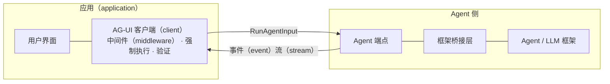
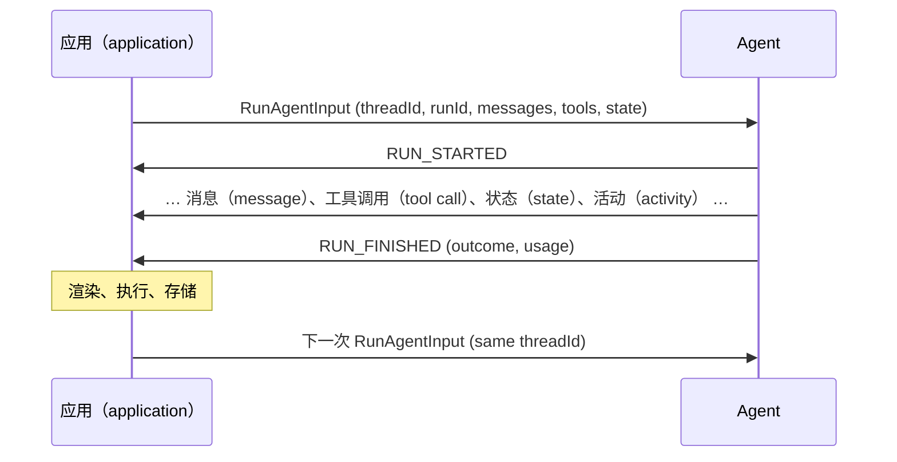

AG-UI 通过一条通道把 Agent 连接到面向用户的应用（application）：一路有序的类型化事件（event），应答单一请求。用户所能看到的 Agent 的一切 —— 文本、工具调用（tool call）、推理（reasoning）、状态（state）、进度 —— 都在流（stream）里；没有旁路。

## 核心组件

### 应用（application）

拥有用户。它渲染流（stream），执行它对外声明过的[工具调用（tool call）](events/tool-calls.md)，保存 Agent 与它共享的[状态（state）](events/state.md)，并决定什么需要用户的同意。

### 客户端（client）

消费者（consumer）侧的协议（protocol）机制，通常是一个 SDK。它发送[运行输入（run input）](basic/run-input.md)，对返回的内容运行[处理流水线](basic/processing.md) —— 兼容性（compatibility）翻译、中间件（middleware）、强制执行、分块（chunk）展开（expansion）、验证 —— 并把一条可信的流（stream）交给应用（application）。

### Agent 端点及其桥接层

生产者（producer）。桥接层把框架的原生事件（event）翻译成协议（protocol）事件（event）；端点讲某种[传输绑定（binding）](basic/transports/index.md)。协议（protocol）不携带任何框架概念，这正是让一个客户端（client）能面对任何框架的原因。

### 中间件（middleware）

任意一方安装到客户端（client）流水线中的代码。它在强制执行剥离（strip）任何东西**之前**看到每一个事件（event），因此兼容垫片（shim）可以翻译[已退役形状（retired shape）](basic/versioning.md#已退役形状retired-shape)，扩展也可以对当前版本（version）未定义的材料采取行动。

## 运行（run）

交互的单元。消费者（consumer）用一次 `RunAgentInput` 开启一次交换；生产者（producer）以被[运行生命周期（run lifecycle）](events/lifecycle.md)包裹的事件（event）作答 —— 所请求的运行（run），前面可能还有重放的历史；对话是由此类运行（run）组成的线程（thread），累积消息（message）与状态（state）。

## 设计原则

1. **Agent 应当极易对外暴露。** 桥接层是一次翻译，而不是一次实现（implementation）：框架发出的任何东西都映射到一小组事件族（event family）上，而所有可选的（optional）东西都是可选的（optional）。强制的表面只有运行生命周期（run lifecycle），别无其他。

2. **一切可观察的东西都在交换之中。** Agent 可见行为中没有任何东西走带外（out-of-band）：持有这些交换的录制器 —— 每个运行输入（run input）以及应答它的事件（event） —— 能重建 UI 在每一时刻所知的一切，这正是让协议（protocol）可测试、可重放且传输无关（transport-agnostic）的原因。

3. **宽容的读者，严格的写者。** 生产者（producer）必须（MUST）只发出 schema 所定义的内容；消费者（consumer）必须（MUST）在遇到它不认识的内容时存活下来，将其剥离（strip）并发出告警（warning），而不是失败。完整的不对称性 —— 以及为什么畸形的已知值会被反向对待 —— 见[处理模型](basic/processing.md)。

4. **中间件（middleware）先于强制执行运行。** 翻译在任何东西被剥离（strip）之前获得机会，因此协议（protocol）可以演进而不让任何一方被困住：昨天的形状在边界（boundary）处被翻译，明天的形状则一路传递到认识它们的人手里。

5. **传输（transport）即绑定（binding）。** 语义绝不随线上（wire）而变。同样的事件（event），同样的规则，无论被分帧（framing）为 SSE 文本还是 protobuf 帧 —— 跨实现一致性由共享的字节语料固定。
