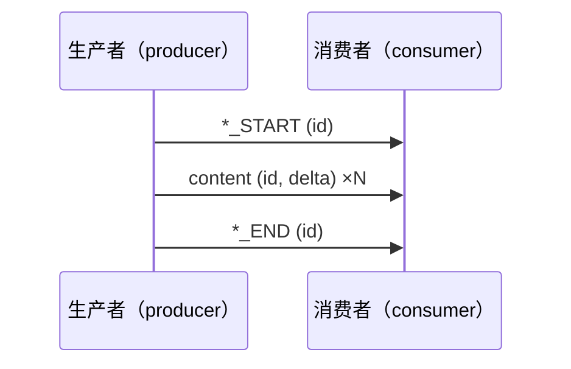
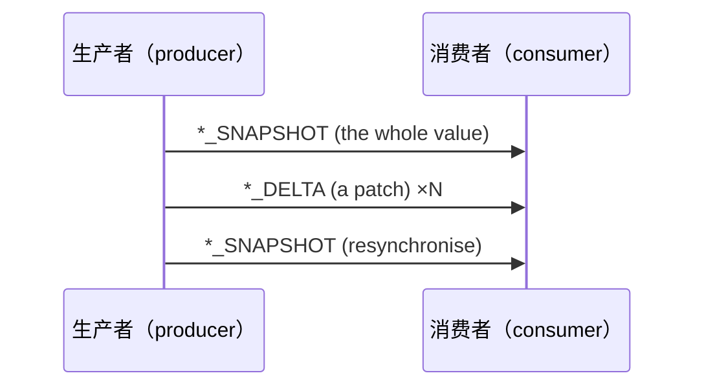
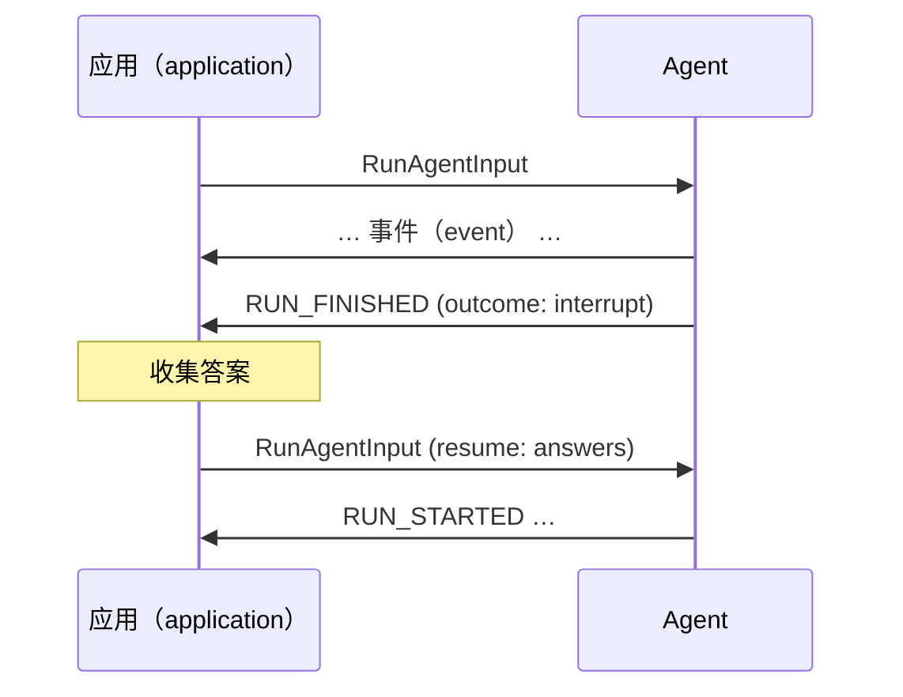

本页定义核心协议（protocol）的事件（event）模式：生产者（producer）把事件（event）组合成流（stream）的方式。每一种[传输（transport）](../transports/index.md)都承载所有这些模式；传输（transport）之间的差别只在于事件（event）如何被分帧（framing）与投递。

协议（protocol）的方向是固定的。事件（event）从生产者（producer）流向消费者（consumer）；消费者（consumer）每次交换只发言一次，即发送开启该交换的[运行输入（run input）](../run-input.md)。生产者（producer）不得（MUST NOT）要求消费者（consumer）发送任何运行中消息 —— 需要外部输入的运行（run）会结束，答案在下一个运行（run）中到达：通过中断（interrupt）及其恢复（resume）条目，或通过一个[前端工具（frontend tool）调用（tool call）](../../events/tool-calls.md#前端工具frontend-tools)留待未答、并在下一次输入的 messages 中作答。

## 流式（streaming）

长的值一次到达一片：一个 `*_START` 开启一项，内容事件（event）扩展它，一个 `*_END` 关闭它 —— 或者分块（chunked）简写（shorthand）把三者压缩在一起。文本消息（text message）、工具调用（tool call）与推理消息（reasoning message）都以这种方式流式传输。

参见[流式消息（message）](streaming.md)。

## 快照（snapshot）与增量（delta）

演进中的值 —— Agent 状态（state）、活动（activity）、对话本身 —— 以替换整体的快照（snapshot）与修正现有值的增量（delta）携带，增量（delta）以 RFC 6902 JSON Patch 表达。

参见[快照（snapshot）与增量（delta）](snapshots.md)。

## 中断（interrupt）与恢复（resume）

需要来自外部某物的运行（run）—— 一次批准（approval）、一个缺失的值 —— 以中断结果（interrupt outcome）结束，而从它继续的运行（run）在其输入中携带答案。

参见[中断（interrupt）与恢复（resume）](interrupt-resume.md)。

## 添加模式

所有协议（protocol）特性都由这些模式构建。新增模式的协议（protocol）修订版本（revision）在本页定义它。传输（transport）无需改动即可承载新模式，因为模式完全以事件（event）与运行输入（run input）来表达。
