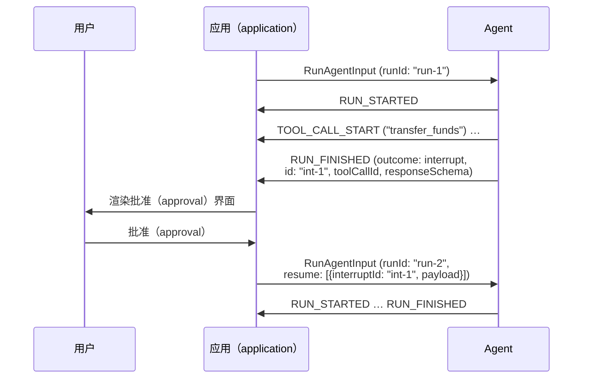

运行（run）有时需要只有外部世界才能给出的东西 —— 一次批准（approval）、一个凭证、一个选择。协议（protocol）没有从消费者（consumer）到生产者（producer）的运行中通道，因此运行（run）不会等待：它结束，说明自己在等什么，而从它继续的运行（run）携带答案。

## 发起中断（interrupt）

需要外部输入的运行（run）以 `RUN_FINISHED` 结束，其 `outcome` 是中断结果（interrupt outcome），携带一个或多个 `Interrupt` 对象 —— 至少一个，因为没有任何东西可答的中断结果（interrupt outcome）会让消费者（consumer）无事可做。

- 生产者（producer）不得（MUST NOT）把被中断（interruption）的运行（run）报告为成功：中断结果（interrupt outcome）是结束一次停下来*询问*的运行（run）的唯一符合一致性（conformance）的方式 —— 生产者（producer）在其中指明自己在等待什么，并由恢复（resume）条目作答。因调用[前端工具（frontend tool）](../../events/tool-calls.md#前端工具frontend-tools)而停止的运行（run）是另一条普通路径：它以成功结束，在成功结果（outcome）的 `pendingToolCallIds` 中指明未作答的调用（tool call），答案则搭乘下一次输入的 messages。因被*要求*而停止的运行（run）两者都不是：它以[已取消（cancelled）结果（outcome）](../../events/lifecycle.md#已取消的运行cancelled-runs)结束，且不索要任何东西。
- 每个中断（interrupt）的 `id` 必须（MUST）在运行（run）内唯一；恢复（resume）条目以此 id 作答。
- 中断（interrupt）的 `reason` 是开放字符串 —— 协议（protocol）并不试图对 Agent 可能需要输入的每一种原因分类。`message` 是给作答者的人类可读提示；`toolCallId` 指明某次批准（approval）所涉及的工具调用（tool call）；`responseSchema` 描述答案的预期形状，以不透明方式携带，以便消费者（consumer）为它构建表单。
- 在子 Agent（subagent）内部引发的中断（interrupt）可以（MAY）携带该子 Agent（subagent）的 `subagentRunId`；[子 Agent（subagent）规则](../../events/subagents.md)管辖归属（attribution）以及随之而来的挂起（suspension）结果（outcome）。

被中断（interrupt）的运行（run）是一个已关闭的运行（run）。[运行生命周期（run lifecycle）](../../events/lifecycle.md)关于已关闭运行（run）的一切规定都适用 —— 包括它所允许的那一次迟到到达，即报告在关闭之后才浮现的失败的 `RUN_ERROR` —— 而继续意味着一个新运行（run）。

## 恢复（resume）

继续的运行（run）在输入的 `resume` 列表中携带答案，每个被作答的中断（interrupt）对应一个 `ResumeEntry`：

- 每个条目的 `interruptId` 必须（MUST）指向被继续的运行（run）中的一个中断（interrupt）—— 即线程（thread）上最近一次被中断（interrupt）的运行（run）。
- 条目的 `status` 说明该中断（interrupt）是被作答还是被放弃；`payload` 携带 Agent 所索要的答案，可以是任何 JSON 值；`metadata` 是关于响应的信封信息，不属于答案的一部分。
- 恢复（resume）列表必须（MUST）覆盖被继续运行（run）的每一个中断（interrupt）：每一个都被作答，或由状态为 abandoned 的条目明确放弃。省略不等于放弃。覆盖是*消费者（consumer）*要执行的规则：消费者（consumer）持有收尾的 `RUN_FINISHED` 所投递的中断（interrupt），并由它组装恢复（resume）列表，因此它是始终能判断列表是否完整的唯一参与者。消费者（consumer）必须（MUST）在运行（run）开始之前 —— 在任何东西被发送之前 —— 拒绝一个留下未覆盖中断（interrupt）的恢复（resume）输入，并且不得（MUST NOT）在缺少某个中断（interrupt）条目的情况下静默越过它。生产者（producer）不被要求检查这一点，也无需保留被中断（interrupt）运行（run）的任何东西即可符合一致性（conformance）；当有缺陷的消费者（consumer）仍然发来不完整列表时它怎么做，属于下文所述的错误处理。被放弃的中断（interrupt）对 Agent 的工作意味着什么，是生产者（producer）自己的事。
- `expiresAt` 刻意不受格式约束，因此中断（interrupt）*是否*已过期，由作出判断的消费者（consumer）自行解读 —— 参考实现把它读作日期，并把当前或更早视为已过期。规则附着在判断上，而不是附着在 schema 拒绝规定的某种解析上：一个被消费者（consumer）判定为已过期的中断（interrupt）不再能被*作答* —— 消费者（consumer）会在运行（run）开始前拒绝解析它的恢复（resume）条目，正如它拒绝未覆盖的中断（interrupt）一样。它仍然可以 —— 而且由于覆盖是强制的，必须 —— 被放弃，线程（thread）正是以此越过一个没人及时作答的中断（interrupt）。
- 线程（thread）与状态（state）的连续性跨越这段间隔：恢复（resume）的运行（run）携带相同的 `threadId`、累积的消息（message），以及被中断（interrupt）运行（run）留下的状态（state），与任何[顺序运行（run）](../../events/lifecycle.md)完全一致。
- 令牌用量不跨越这段间隔：恢复（resume）运行（run）的 `usage` 只[覆盖](../../events/lifecycle.md#token-用量token-usage)它自己发起的模型调用。被中断（interrupt）的运行（run）已在使其中断（interrupt）的那个 `RUN_FINISHED` 上报告了自己的用量。

收到恢复（resume）条目的生产者（producer）把它们当作自己停下来等待的答案。该列表是消费者（consumer）就所决定之事作出的完整陈述，生产者（producer）如此采纳它：它不被要求记住先前运行（run）的中断（interrupt）、把该列表与它们比对，或为此在运行（run）之间保留任何状态（state）。一个不跨越这段间隔携带任何东西的生产者（producer）是符合一致性（conformance）的。

对消费者（consumer）规则的两类违反仍可能到达生产者（producer）。以下是生产者（producer）对它们的错误处理，而不是允许发送它们的许可。

- **不被识别的条目** —— 指向生产者（producer）未引发的中断（interrupt）：运行（run）应当（SHOULD）在没有该条目的情况下继续，生产者（producer）应当（SHOULD）发出告警（warning），而不是因为一个它从未索要的答案让运行（run）失败。

- **未被覆盖的中断（interrupt）** —— 生产者（producer）能够判断它仍然打开且没有条目，因为它保留了被中断（interrupt）运行（run）的检查点（checkpoint），或因为消息（message）携带一个受批准（approval）约束的工具调用（tool call），既没有结果（tool result）也没有作答的条目。生产者（producer）不得（MUST NOT）凭借缺失的条目执行被中断（interrupt）的动作，也不得（MUST NOT）把省略视为放弃 —— 丢弃该调用（call）并发出告警（warning）后以成功结束，会让有缺陷的消费者（consumer）放弃没人决定要放弃的东西，而这正是覆盖规则要防止的结果。一旦发现，生产者（producer）就保持该中断（interrupt）打开。它可以（MAY）在运行（run）开始前拒绝该输入，如同任何无效输入（以 `RUN_ERROR` 开启的流（stream），或传输（transport）自身对请求的拒绝）；或者它可以（MAY）运行被覆盖条目所允许的部分，并再次以中断结果（interrupt outcome）结束，携带仍然打开的中断（interrupt），让消费者（consumer）获得另一次作答机会。无论哪种方式，只要有一个生产者（producer）知道仍打开着的中断（interrupt）未获作答，运行（run）就不得（MUST NOT）以成功结束。无法判断的生产者（producer）—— 上述无状态情形 —— 在此没有义务，因为它没有可发现的东西。

## 消息（message）流（stream）

## 数据类型

[`RunFinishedInterruptOutcome`](../../schema.md#runfinishedinterruptoutcome)、[`Interrupt`](../../schema.md#interrupt) 与 [`ResumeEntry`](../../schema.md#resumeentry) 由 [schema 参考](../../schema.md)定义。`expiresAt` 若存在，按惯例携带 ISO 8601 时间戳；schema 刻意不约束其格式。

## 错误处理

携带中断（interrupt）的成功结果（outcome）是 schema 已经拒绝的矛盾 —— 成功结果（success outcome）是封闭对象（closed object）。在一个并不继续被中断（interrupt）运行（run）的运行（run）上给出恢复（resume）列表，什么也回答不了；生产者（producer）把其中的条目当作不被识别，如上文所述。
