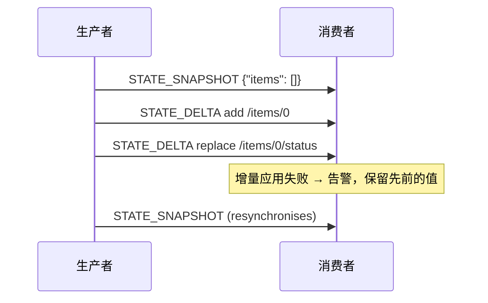

生产者（producer）报告的内容中，有些不是文本流，而是一个演进的值：Agent 的状态（state）、活动（activity）的内容、对话本身。它们以**快照（snapshot）**（替换整体）与**增量（delta）**（修正现有值）的形式传输。

三个事件族使用这一模式：[状态](../../events/state.md)（`STATE_SNAPSHOT`、`STATE_DELTA`，以及用于对话的 `MESSAGES_SNAPSHOT`）与[活动](../../events/activity.md)（`ACTIVITY_SNAPSHOT`、`ACTIVITY_DELTA`）。本页陈述它们共有的部分；各事件族页面陈述各自替换与修正的内容。

## 快照（snapshot）

快照携带整个值。消费者（consumer）必须（MUST）把自己的副本替换为快照的内容 —— 快照不是合并 —— 除非快照本身通过其事件族定义的某个字段选择退出（[活动](../../events/activity.md)的 `replace: false` 是唯一一例）。在它之前的任何增量都已用尽：快照无论被应用还是被拒绝，都是新的基线时刻。

生产者可以（MAY）在任何时候发送快照，并且应当（SHOULD）在无法保证消费者的基线与自己的基线一致时发送 —— 例如在错误之后、在增量无法表达的内容之后，或在继续旧线程（thread）的运行（run）开始时。

## 增量（delta）

增量修正当前值，以 [RFC 6902](https://datatracker.ietf.org/doc/html/rfc6902) JSON Patch 表达：一组按顺序原子应用的操作 —— 若任一操作失败，文档保持原样。

- 增量针对消费者的当前值应用：即最后一个快照经此后每一个增量修正后的结果。对于状态，运行起始的值是输入的 `state`，或在输入[未携带任何状态](../run-input.md#state)时为空对象。
- 生产者不得（MUST NOT）为它没有给消费者任何基线的值发送增量。什么算基线由事件族自行决定 —— 状态从输入起就有基线，活动只在首次快照之后才有。
- Patch 操作刻意是开放对象：schema 如此标记它们，而 RFC 6902 未定义的成员是协议合法的材料，[处理模型](../processing.md)不得（MUST NOT）剥离它。

## 当补丁无法应用时

结构性有效并不意味着补丁能够应用：一个良构的操作可能指向不存在的路径，RFC 6902 把这一点留给应用者。畸形的*操作* —— 补丁不是数组、操作缺少必需（required）成员或成员类型错误 —— 是畸形的已知值，像任何其他畸形值一样致命。`op` 命名了 RFC 6902 未定义内容的操作不是畸形，而是不被识别 —— 属于在该消费者发布之后才加入的可辨识联合的成员 —— 适用[处理模型](../processing.md)的列表规则：该元素会从补丁中丢弃并发出告警，运行继续存活。良构但应用失败的补丁又有所不同：

- 消费者不得（MUST NOT）保留部分应用的结果 —— RFC 6902 的应用是原子的。
- 消费者必须（MUST）把失败暴露出来 —— 一条能指明什么失败以及为什么失败的告警，足以诊断 —— 并且可以（MAY）保留其先前的值继续，而不是让运行失败。
- 失败的 `test` 操作属于同一种情况：补丁无法应用，消费者保留其先前的值。

此后消费者的值可能已与生产者的值分离。得知这一点或无法排除这一点的生产者应当（SHOULD）用快照重新同步；消费者必须（MUST）采纳下一个快照，无论它此前跳过了什么 —— 这正是恢复之所以可能的原因。

## 消息（message）流

## 数据类型

补丁的形状 —— [`JsonPatch`](../../schema.md#jsonpatch)、它的操作、[`JsonPointer`](../../schema.md#jsonpointer) —— 由 [schema 参考](../../schema.md)按引用 RFC 6902 的方式定义。
