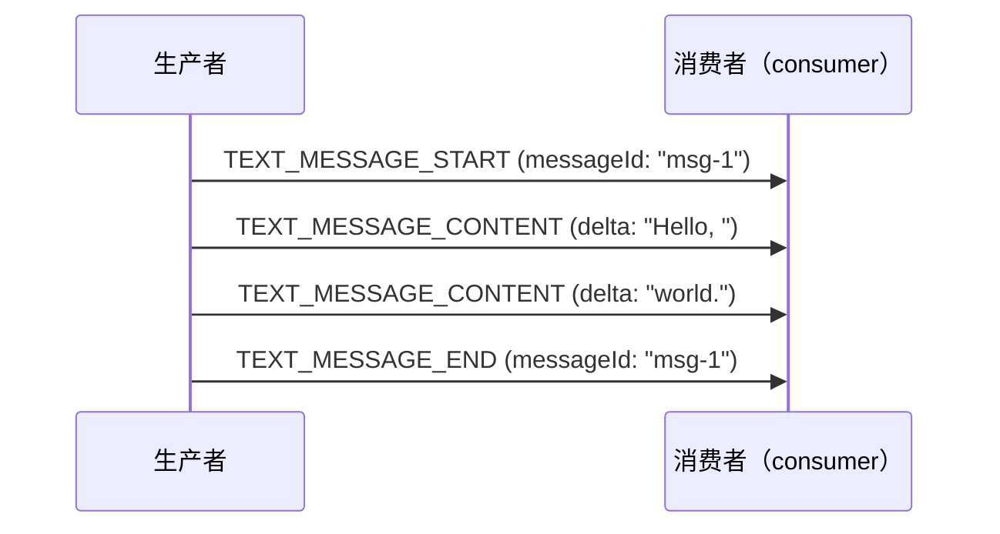
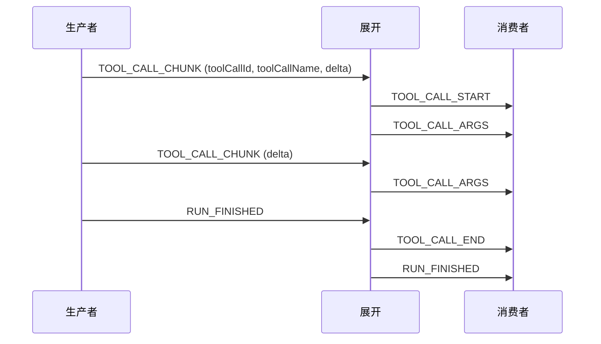

三个事件族（event family）一次一片地流式传输长的值：文本消息、工具调用（tool call）与推理消息。三者都遵循同一个模式，只有两种拼写 —— 显式的**开启–内容–关闭**三元组，以及为否则必须缓冲的生产者（producer）准备的紧凑**分块**形式。本页只定义一次该模式；各事件族页面（[文本消息](../../events/text-messages.md)、[工具调用](../../events/tool-calls.md)、[推理（reasoning）](../../events/reasoning.md)）只补充各自特有的内容。

## 开启、内容、关闭

一个流式项由其 `*_START` 事件（event）开启，由零个或多个内容事件扩展，并由其 `*_END` 事件关闭，全部以该项的标识符（消息（message）为 `messageId`，工具调用为 `toolCallId`）匹配。

- 生产者不得（MUST NOT）开启一个标识符已经打开着的项。
- 生产者不得（MUST NOT）为一个未打开的标识符发送内容事件或结束事件。
- 生产者开启的每一项都必须（MUST）在运行（run）结束之前关闭。

开启事件携带描述该项的字段；内容事件只携带标识符与一个 `delta`。增量（delta）按到达顺序拼接，构成该项的值。

## 交错

消息、工具调用、推理消息与步骤彼此独立。生产者可以（MAY）自由交错它们 —— 消息仍在流式传输时工具调用可以（MAY）开启 —— 只要每一项遵守自己的开启/关闭纪律。

独立事件（`STATE_SNAPSHOT`、`STATE_DELTA`、`MESSAGES_SNAPSHOT`、`ACTIVITY_SNAPSHOT`、`ACTIVITY_DELTA`、`CUSTOM`、`RAW`、`REASONING_ENCRYPTED_VALUE`）不开启也不关闭任何自己的项，并且可以（MAY）出现在已打开的运行内的任何位置。在分块形式中，其中有些确实会结束一个打开的分块流—— 到达本身就是告诉消费者简写无法再继续 —— 正如[关闭分块流](#关闭分块流)所列。

## 分块形式

`TEXT_MESSAGE_CHUNK`、`TOOL_CALL_CHUNK` 与 `REASONING_MESSAGE_CHUNK` 是三元组的紧凑拼写。消费者必须（MUST）在验证之前、在应用代码之前把它们展开为 start/content/end 形式，因此三元组的每条规则都适用于展开后的事件。展开相对于强制执行与中间件（middleware）处于什么位置，在[处理模型](../processing.md)中规定；在每条路径上都成立的不变量是：一个分块按它所是的事件来判定 —— 最先遇到畸形的分块的那个阶段会拒绝它，而不是修复它。

两种拼写不会在一个项内混用。由分块开启的项以分块形式继续并关闭 —— 它的 `*_END` 是合成出来的，从不发送 —— 而由 `*_START` 开启的项被显式继续并关闭。一个显式事件若携带某个分块流正在组装的标识符，它就不是该流的续块：它会结束简写，如[关闭分块流](#关闭分块流)所述，随后发生的事由三元组规则判定 —— 这使得在一个项内混用两种形式成为生产者不得（MUST NOT）发出的畸形序列。

### 首个分块

项的第一次分块携带开启它所需的内容；后续分块可以（MAY）省略那些字段，并继续已经打开的内容。

- 一条消息的第一个 `TEXT_MESSAGE_CHUNK` 必须（MUST）携带 `messageId`。它可以（MAY）携带 `role`；缺省的 role 意味着 `assistant`，与 `TEXT_MESSAGE_START` 上完全一致。
- 一条消息的第一个 `REASONING_MESSAGE_CHUNK` 必须（MUST）携带 `messageId`。
- 一次调用的第一个 `TOOL_CALL_CHUNK` 必须（MUST）同时携带 `toolCallId` 与 `toolCallName`。

消费者必须（MUST）把缺少必需（required）字段的首个分块视为协议违规，而不是自行发明一个标识符。

### 续块

- 后续分块若携带标识符，必须（MUST）携带它所继续的同一标识符。命名了不同标识符的分块会开启一个新项，而前一项先关闭。
- 续块可以（MAY）重复其开启者已确立的字段—— 文本消息上的 `role` 或 `name`，工具调用上的 `toolCallName` 或 `parentMessageId` —— 但只能取相同的值。消费者必须（MUST）把冲突的重复视为协议违规。这包括与开启者通过省略所确立的值相冲突：一条不带 role 开启的消息是一条 `assistant` 消息，后续分块声称另一个 role 就与它矛盾。

> [!NOTE]
> 冲突重复规则与[子 Agent（subagent）归属规则](../../events/subagents.md)对某个续块所作出的判断相同 —— 该续块在 `subagentRunId` 上与它的开启者不一致：生产者对同一个项说了两件互不相容的事，而在这两者之间不存在正确的选择方式。

### 关闭分块流

分块形式没有显式结束事件，因此消费者在流无法继续时合成 `*_END`：

- 当某个分块在同一泳道内开启另一个项时；
- 当消息、工具调用、步骤、状态（state）、自定义或推理事件到达该项的泳道时 —— 有四个例外不参与组装、也不关闭任何东西：`RAW`、`ACTIVITY_SNAPSHOT`、`ACTIVITY_DELTA`、`REASONING_ENCRYPTED_VALUE`（以及 `SUBAGENT_STARTED`，它开启一条新泳道，而不是触碰这一条）；
- 当运行级事件到达时 —— `RUN_STARTED`、`RUN_FINISHED`、`RUN_ERROR` 或 `MESSAGES_SNAPSHOT` —— 它会关闭每一条泳道；或者当该项所归属的子 Agent 终止时，这会关闭该子 Agent 的泳道。

一个简写续块属于哪条泳道 —— 父 Agent 的还是某个子 Agent 的 —— 由[归属规则](../../events/subagents.md)决定；而对于既不带标识符也不带标签的续块，则由解析决定：若存在父 Agent 的同类打开流，它继续该流，否则继续唯一的同类打开流。当多条泳道都持有该类型的打开流且没有一条属于父 Agent 时，该续块没有唯一的指称对象，必须（MUST）作为有歧义而被拒绝 —— 运行并行子 Agent 的生产者必须（MUST）为其续块标注归属。分块流不得（MUST NOT）比其所有者活得久：由子 Agent 开启的项，关闭时间不得晚于该子 Agent 的终止事件。

### 分块元数据（metadata）

一个分块的 `metadata` 适用于由该分块合成的事件，并按[元数据（metadata）规则](../metadata.md)合入该项。只携带元数据的续块 —— 例如一个报告用量与结束原因的末块 —— 是合法的：它不增加内容，而其元数据仍会到达它所继续的项。
