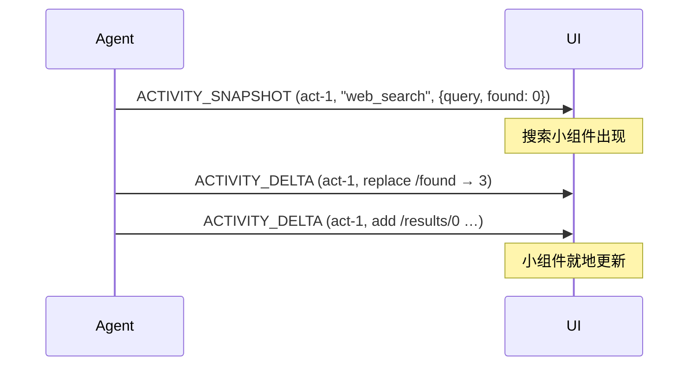

活动（activity）是并非对话内容的结构化进度——一次正在进行的搜索、一份正在填写的清单、一个 UI 渲染为自有小组件的步骤。它被物化为一条消息（message），以保持在序列中的位置，但它的内容是对象，而不是文本。

## 事件（event）

活动绑定[快照–增量模式（snapshot–delta pattern）](../basic/patterns/snapshots.md)，作用域为每条活动消息，以 `messageId` 匹配。

### `ACTIVITY_SNAPSHOT`

创建或替换一条活动消息。

```json
{
  "type": "ACTIVITY_SNAPSHOT",
  "messageId": "act-1",
  "activityType": "web_search",
  "content": { "query": "…", "found": 3 }
}
```

- `activityType` 是一个开放字符串：取值集合属于生产者（producer），而不属于协议。消费者（consumer）必须（MUST）容忍它不认识的类型。
- 针对一个消费者尚未见过的 `messageId` 的快照（snapshot），会在到达的位置创建该活动消息。
- 针对一条已存在活动的快照会替换它的内容与 `activityType`。`replace` 是可选（OPTIONAL）的；缺席意味着它会替换，而这个含义是规范性（normative）的。显式的 `replace: false` 要求消费者保持现有消息原样——内容*与* `activityType` 皆然；快照自己的取值只在它创建消息时才生效。它不是一次合并。
- 替换替换的是*内容*，而不是迄今累积的元数据（metadata）——元数据依[元数据规则](../basic/metadata.md)继续合并。归属是例外：替换型快照会重新铸出这条活动，因此消息的 `subagentRunId` 变成快照自己的，包括变成缺席。
- 针对一条已存在活动的 `replace: false` 快照不会重新铸出所有权：既定的所有者保持不变，而快照自己的归属必须（MUST）与之一致。生产者的义务与[子 Agent 规则](subagents.md)加在流式续篇上的那条相同；消费者的义务被有意放得更宽——既定的所有者保持不变，不要求消费者拒绝这种不一致，而流式续篇的不匹配必须被拒绝。

### `ACTIVITY_DELTA`

用针对某条活动消息的 RFC 6902 patch 修改它的内容。增量（delta）的 `activityType` 会替换该消息的 `activityType`——增量可以（MAY）重设它所修改的活动的类型，而无意重设的增量必须（MUST）重述当前类型，因为该字段是必需（required）的。

- 生产者不得（MUST NOT）为一条它没有用快照创建过的活动消息发送增量——快照是[模式](../basic/patterns/snapshots.md)所要求的基线。
- 一个指名了不存在的消息、或指名了非活动消息的增量会被跳过；消费者应当（SHOULD）给出告警，并且不得（MUST NOT）让运行（run）失败。
- 打上 patch 之后的结果仍必须（MUST）是对象：`content` 按 schema 就是对象，生产者不得（MUST NOT）发送一个其应用结果会把它变成别的东西的 patch——比如根替换。不要求消费者检测该违规。
- patch 失败的处理是[模式](../basic/patterns/snapshots.md#当补丁无法应用时)的规则，并通过同一 `messageId` 的一份全新快照重新同步。

## 对话中的活动消息

活动消息以固定角色`activity` 出现在历史中。它是供消费者渲染的材料，而不是 Agent 据以恢复（resume）的对话：消费者必须（MUST）把活动消息从它在[运行输入（run input）](../basic/run-input.md)中发送的 `messages` 里剥离。活动消息如何在 `MESSAGES_SNAPSHOT` 之后存活，规定在那个[事件（event）](state.md#messages_snapshot)中。

## 消息流



## 数据类型

[`ActivitySnapshotEvent`](../schema.md#activitysnapshotevent)、[`ActivityDeltaEvent`](../schema.md#activitydeltaevent) 与 [`ActivityMessage`](../schema.md#activitymessage) 由 [schema 参考](../schema.md)定义。[`ActivityMessage`](../schema.md#activitymessage) 独立存在，而不组合基础消息，因为它的内容是对象而不是字符串。

## 错误处理

畸形的活动事件作为畸形的已知值是致命的。两种被容忍的失败——针对缺失消息或非活动消息的增量，以及格式良好却无法应用的 patch——会告警并跳过，如上所述；两者都可能让生产者与消费者对该活动产生分歧，这由生产者的下一个快照修复。
