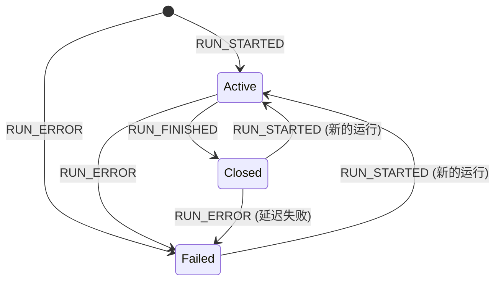

消费者（consumer）发送一个 [`RunAgentInput`](../basic/run-input.md)；生产者（producer）以事件（event）流（stream）作答，其中承载一次或多次运行（run）——所请求的那次运行（run），前面可能还有被重放（replay）的历史。本页说明一次运行（run）何时开始、何时结束，以及这些边界（boundary）意味着什么；运行（run）*内部*的排序规则属于[事件模式（event patterns）](../basic/patterns/index.md)。

## 运行（run）

一条流（stream）必须（MUST）以 `RUN_STARTED` 或 `RUN_ERROR` 开始。生产者（producer）不得（MUST NOT）先发出任何其他事件（event），消费者（consumer）必须（MUST）把以其他任何事件（event）开头的流（stream）视为协议（protocol）违规。之所以允许 `RUN_ERROR` 排在第一位，是因为运行（run）可能在开始之前就失败——一个无法触达 Agent 的传输（transport）有失败要报告，却没有可据以报告这次失败的运行（run）。

### `RUN_STARTED`

开启这次运行（run）。它携带这次运行（run）的标识符；携带生产者（producer）自己的 `protocolVersion` 声明，依据[版本规则（versioning rules）](../basic/versioning.md#版本协商version-negotiation)；并且可以（MAY）回显这次运行（run）启动时所依据的输入（input），这样没有发起该请求的消费者（consumer）仍能看到 Agent 被要求做什么。`parentRunId` 指明催生这次运行（run）的那次运行（run），适用于某个 Agent 把另一个 Agent 作为独立运行（run）、而非作为某次运行（run）内的[子 Agent（subagent）](subagents.md)来调用的情况。

### `RUN_FINISHED`

关闭一次没有失败的运行（run），并报告它是如何结束的：

- 它的 `outcome` 区分已完成（completed）的运行（run）、因等待外部输入而被中断（interrupt）的运行（run），以及在完成之前被停止的运行（run）；结果（outcome）缺席表示成功。中断（interrupt）结果以及它之后的内容规定在[中断与恢复（Interrupts and Resume）](../basic/patterns/interrupt-resume.md)中；已取消（cancelled）结果规定在[下文](#已取消的运行cancelled-runs)。结果（outcome）报告的是生产者（producer）所知道的、关于这次运行（run）为何结束的信息：在一次[前端工具调用（frontend tool call）](tool-calls.md#前端工具frontend-tools)上停下的运行（run）是一次已完成的运行（run），它的成功结果（outcome）可以（MAY）在 `pendingToolCallIds` 中列出它留下未作答的调用（call），因为在这类调用（call）之后应用（application）是否继续该线程（thread），是应用（application）的决定，而不是生产者（producer）的决定。
- 生产者（producer）不得（MUST NOT）发送 schema 未描述的结果（outcome）值。
- `result` 是可选（OPTIONAL）的，携带这次运行（run）的返回值（如果它有返回值的话）。
- `usage` 是可选（OPTIONAL）的，报告 token 用量，按提供方（provider）与模型各一条，依据[下文的计量方式](#token-用量token-usage)。只想要总量的消费者（consumer）把各条记录相加即可。

消费者（consumer）不认识的结果（outcome）和任何其他东西一样属于未识别材料（unrecognised material），并按同样的条件被剥离（strip）。剥离（strip）一个可选（optional）字段会让它缺席，而结果（outcome）缺席意味着成功——所以消费者（consumer）不必去分辨一次已完成的运行（run）与一次因某个在该消费者（consumer）发布之后才被命名的原因而结束的运行（run）。

> [!NOTE]
> 这限制了结果（outcome）集合能够有益地增长到多大程度。在后续版本中新增的终止状态（terminal state），到达较旧的消费者（consumer）时会呈现为一次成功的运行（run）；因此，如果一个版本需要较旧的消费者（consumer）*注意到*某种新的结束方式，就无法仅通过 `outcome` 来说明——它需要一个这些消费者（consumer）已经视为有意义的载体。这也正是为什么下文的已取消（cancelled）结果在 1.0 中就被命名，而不是留到以后：若事后再加，一次已取消的运行（run）在每个 1.0 消费者（consumer）看来都会是一次已完成的运行（run）。

### 已取消的运行（cancelled runs）

一次运行（run）可以在完成之前被有意停止——被它所服务的人、被应用（application）自己的代码、被生产者（producer）施加的某个限制。它没有失败，也不在等待任何东西，但它同样没有完成；无法把它与已完成的运行（run）区分开的消费者（consumer），会把不完整的工作当作全部来呈现。已取消（cancelled）结果就是为这种结束方式命名的。

- 生产者（producer）若因非失败原因在完成前停止一次运行（run），必须（MUST）以携带已取消（cancelled）结果的 `RUN_FINISHED` 关闭它。它不得（MUST NOT）把已停止的运行（run）报告为成功——既不能用成功结果（outcome），也不能靠省略结果（outcome）。
- 对已关闭运行（run）成立的一切在这里同样成立。生产者（producer）必须（MUST）在取消它的 `RUN_FINISHED` 之前，把这次运行（run）开启的一切关闭——消息（message）、工具调用（tool call）、步骤（step）、子 Agent（subagent）——与在一次成功结束的运行（run）之前完全一样。关闭一个工具调用（tool call）确立的是它的参数（args）文本完整，而不是有效，所以一个在参数（args）中途被切断的调用（call）会和其他调用（call）一样关闭，而如何处理无法解析的参数（args）是应用（application）的决定，依据[工具调用规则（tool call rules）](tool-calls.md#tool_call_end)。无法按序关闭的生产者（producer）——停止操作把它下方的流（stream）拆掉了——改为报告 `RUN_ERROR`：那次运行（run）没有干净地结束，而 `RUN_ERROR` 正是为没有干净结束的运行（run）准备的事件（event）。
- 已取消的运行（run）没有返回值：`result` 应当（SHOULD）缺席。`usage` 可以（MAY）报告停止之前累积的 token。
- 已取消的运行（run）不等待任何东西。它的结果（outcome）不携带中断（interrupt），该线程（thread）上紧接着的运行（run）是一次普通的新运行（run），而不是恢复（resume）。
- 消费者（consumer）不得（MUST NOT）把已取消的运行（run）呈现为已成功，也不得（MUST NOT）呈现为已失败——用户要求的停止不是要展示给他们的错误。这次运行（run）在停止之前投递的一切依然算数，正如 `RUN_ERROR` 之后一样。除此之外如何呈现这次停止，是消费者（consumer）自己的事。

取消（cancellation）是生产者（producer）关于它正在运行（run）的运行（run）的报告。放弃一条流（stream）的消费者（consumer）——关闭连接、停止读取——拥有的是一个[被截断的运行（truncated run）](../basic/transports/index.md#截断truncation)，而不是已取消（cancelled）的运行（run）：对于一次从未收到结束事件的运行（run），它不得（MUST NOT）合成 `RUN_FINISHED`，无论是不是已取消（cancelled）。

### `RUN_ERROR`

结束一次失败的运行（run）。`message` 说明哪里出了问题，供人阅读；`code` 是可选（OPTIONAL）的、机器可读的，是一个开放字符串，协议（protocol）不为它定义任何词汇；`usage` 可以（MAY）报告失败之前累积的 token，采用与 `RUN_FINISHED` 上相同的[计量方式](#token-用量token-usage)。

`RUN_ERROR` 是一个格式良好的事件（event）：生产者（producer）在报告自己的失败，而不是发送什么消费者（consumer）应当拒绝的东西。把一次运行（run）视为失败，意味着消费者（consumer）必须（MUST）把该失败暴露给应用（application）代码，并且不得（MUST NOT）把这次运行（run）报告为已成功。它并不规定怎么做——启动这次运行（run）的那次调用是抛错、是以失败兑现，还是通过回调报告，都是实现层面的事，两个符合规范（conformance）的消费者（consumer）可以不同。

### token 用量（token usage）

`RUN_FINISHED` 与 `RUN_ERROR` 上的 `usage` 报告这次运行（run）的模型调用花了多少，每个提供方（provider）与模型一条 [`TokenUsage`](../schema.md#tokenusage) 记录。各提供方（provider）的计数方式不同——有的把缓存的提示词 token 并入输入计数，有的把它并列在输入计数旁边，还有的把推理（reasoning）与输出的其余部分分开报告——所以协议（protocol）固定了一套计量方式，由生产者（producer）换算进来。每个计数要么是一个总量，要么是某个总量的具名部分：

- `inputTokens` 是这次调用被计费的每一个提示词 token：无论是否缓存、是否写入缓存、是否为文本。`outputTokens` 是每一个生成的 token，包括推理（reasoning）。
- `cachedInputTokens`（缓存读取）、`cacheWriteInputTokens`（缓存写入）和 `reasoningTokens` 是这些总量的组成部分，绝不是它们的附加项。两个缓存计数互不相交。若生产者（producer）的提供方（provider）把其中一项与一个更小的总量并列报告，生产者（producer）必须（MUST）在发出该条记录之前把它加进总量；若提供方（provider）已经把它包含在内，生产者（producer）不得（MUST NOT）再次相加。
- `totalTokens` 是 `inputTokens` 加 `outputTokens`。生产者（producer）可以（MAY）自行计算它，而不是照抄提供方（provider）的总量；并且不得（MUST NOT）照抄一个计数方式不同的提供方（provider）总量。
- 计数缺席意味着提供方（provider）没有报告它；零意味着它报告了零。生产者（producer）不得（MUST NOT）为自己没有数据的计数发出零，消费者（consumer）也不得（MUST NOT）把缺席的计数读作零。

运行（run）就是计量的边界（boundary）：

- 用量（usage）覆盖这次运行（run）内做出的每一次模型调用，包括它的[子 Agent（subagent）](subagents.md)所做的调用：子 Agent（subagent）事件（event）不携带自己的用量（usage），子 Agent（subagent）的调用就是这次运行（run）的调用。
- 作为独立运行（run）被调用的 Agent——由 `parentRunId` 指明——在自己的终止事件（terminal event）上报告自己的用量（usage），而催生它的那次运行（run）不得（MUST NOT）把该用量（usage）计入自己的用量（usage）。
- [恢复（resume）](../basic/patterns/interrupt-resume.md)一次被中断（interrupt）运行（run）的运行（run），只报告它自己做出的调用。被中断（interrupt）的运行（run）已经报告过自己的用量（usage）；想要某个线程（thread）总量的消费者（consumer），把该线程（thread）的各次运行（run）相加即可。

按这套计量方式，只想要总量的消费者（consumer）把各条记录、各次运行（run）的 `totalTokens` 相加；计算成本的消费者（consumer）则拥有它需要的每个部分，可以按各自的费率为缓存读取、缓存写入和推理（reasoning）计价，而不会对其中任何一项重复计算。

### 一次运行（run）关闭之后

一次运行（run）以 `RUN_FINISHED` 或 `RUN_ERROR` 结束，此后它便是已关闭的。一旦某次运行（run）已关闭：

- 生产者（producer）不得（MUST NOT）为那次运行（run）再发出任何事件（event），下面列出的两种除外。
- 生产者（producer）可以（MAY）发出 `RUN_STARTED`，在同一条流（stream）上开始一次新的运行（run）。
- 生产者（producer）可以（MAY）在 `RUN_FINISHED` 之后发出 `RUN_ERROR`，报告一次在运行（run）已报告成功之后才浮现的失败——比如刷新时的传输（transport）错误。这种情况下，消费者（consumer）必须（MUST）把这次运行（run）视为失败。
- 生产者（producer）不得（MUST NOT）在 `RUN_ERROR` 之后发出任何东西，`RUN_STARTED` 除外。

消费者（consumer）必须（MUST）拒绝在一次运行（run）关闭之后到达的任何其他事件（event）。

### 一条流（stream）上的多次运行（run）

单条流（stream）可以（MAY）按顺序承载多次运行（run）——重放（replay）一个线程（thread）是常见情形。生产者（producer）必须（MUST）在开启下一次运行（run）之前关闭当前的运行（run）：在某次运行（run）仍处于活动状态时发出 `RUN_STARTED`，就是违规。

在一条流（stream）内的多次运行（run）之间，消息（message）会累积，[状态（state）](state.md)会持续存在，除非有事件（event）替换它。生产者（producer）重述历史时——重放（replay）一个线程（thread），其材料已由消费者（consumer）的输入（input）携带——必须（MUST）以快照（snapshot）的形式重述：`MESSAGES_SNAPSHOT` 按 id 对账，`STATE_SNAPSHOT` 则做替换，因此消费者（consumer）已经持有的重述是幂等（idempotent）的。重新流式（stream）发送一条消费者（consumer）已拥有的消息（message），是向它追加而不是重述它，这也是流式（streaming）三元组只用于新素材的原因。

运行（run）范围内的跟踪——打开的消息（message）、打开的工具调用（tool call）、打开的步骤（step）、活动的子 Agent（subagent）——不跨越这个边界（boundary）：`RUN_FINISHED` 要求这次运行（run）打开的一切都已关闭，而 `RUN_ERROR` 会随运行（run）一起终结仍然打开的一切。新的运行（run）从不带任何打开项的状态开始。

## 步骤（step）

步骤（step）为展示进度的 UI 标记运行（run）的各个阶段。`STEP_STARTED` 开启一个步骤（step），`STEP_FINISHED` 关闭它，以 `stepName` 匹配。

- 生产者（producer）不得（MUST NOT）开启一个名称已处于打开状态的步骤（step），也不得（MUST NOT）结束一个从未开启的步骤（step）。
- 生产者（producer）开启的每个步骤（step）都必须（MUST）在运行（run）结束之前关闭。
- 步骤（step）可以（MAY）彼此重叠，也可以与运行（run）中的任何其他东西重叠；步骤（step）是覆盖流（stream）中一段区间的标签，而不是容器。

## 数据类型

事件（event）的形状由 [schema 参考](../schema.md)定义：[`RunStartedEvent`](../schema.md#runstartedevent)、[`RunFinishedEvent`](../schema.md#runfinishedevent)（含 [`RunFinishedOutcome`](../schema.md#runfinishedoutcome)）、[`RunErrorEvent`](../schema.md#runerrorevent)、[`StepStartedEvent`](../schema.md#stepstartedevent)、[`StepFinishedEvent`](../schema.md#stepfinishedevent) 以及 [`TokenUsage`](../schema.md#tokenusage)。

## 错误处理

有两件不同的事会让一次运行（run）以糟糕的方式结束，消费者（consumer）要把它们区分开。

**被消费者（consumer）拒绝的流（stream）**是它检测到的协议（protocol）违规：本页中生产者（producer）不得（MUST NOT）做的一切，一旦消费者（consumer）看到就是致命的——`RUN_STARTED` 之前的事件（event）、关闭之后除那两种获准事件（event）之外的任何事件（event）、嵌套的 `RUN_STARTED`、不配对的步骤（step），或者在 `RUN_FINISHED` 时仍然打开的任何东西。错在生产者（producer），这条流（stream）也不可信。

**用 `RUN_ERROR` 报告自身失败的运行（run）**正相反：一个符合规范（conformance）的生产者（producer）在说它的工作没有成功。流（stream）是格式良好的，消费者（consumer）依上文的规则接受它。

消费者（consumer）不得（MUST NOT）把两者中的一种呈现为另一种。任何一种失败的运行（run）都保留它在失败之前投递的一切——`RUN_ERROR` 说明这次运行（run）没有完成，而不是它的事件（event）没有发生。
