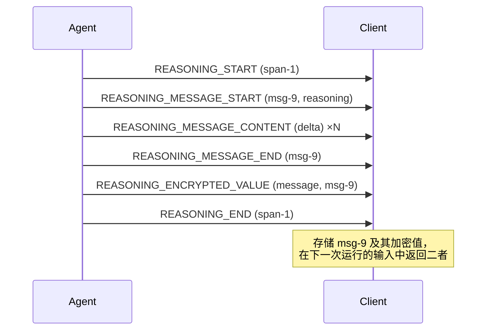

推理（reasoning）是模型在作答之前所思考的东西。生产者（producer）把它流式（streaming）送出，让 UI 能展示进行中的工作；并且在提供方（provider）把真正的思维链保持私密的地方，携带一个加密产物（encrypted artefact），由消费者（consumer）存储并原样返回，而消费者（consumer）本身读不懂它。

## 用户交互模型

推理（reasoning）通常与对话分开渲染——默认折叠，以 thinking 的风格呈现。协议（protocol）不强制任何呈现方式；消费者（consumer）可以（MAY）完全隐藏推理（reasoning）。

## 事件（event）

### 推理区间（reasoning span）：`REASONING_START` 与 `REASONING_END`

一个推理区间（reasoning span）括住一段思考，由 `REASONING_START` 开启、`REASONING_END` 关闭，以 `messageId` 匹配。一个区间（span）可以（MAY）包含多条推理消息（reasoning message）。

- 生产者（producer）不得（MUST NOT）开启一个 `messageId` 已处于打开状态的区间（span），必须（MUST）在运行（run）结束之前关闭它开启的每一个区间（span），并且不得（MUST NOT）关闭一个不是它开启的区间（span）。
- 区间（span）的标识符不构成任何命名空间：区间（span）内的推理消息（reasoning message）携带各自的 `messageId`。

### 推理消息（reasoning message）

推理消息（reasoning message）遵循[流式模式（streaming pattern）](../basic/patterns/streaming.md)：`REASONING_MESSAGE_START` 开启一条（它的 `role` 固定为 `reasoning`），`REASONING_MESSAGE_CONTENT` 扩展它，`REASONING_MESSAGE_END` 关闭它，全部以 `messageId` 匹配——而 `REASONING_MESSAGE_CHUNK` 是紧凑写法，其首个分片（chunk）必须（MUST）携带 `messageId`。该模式的规则与文本消息（text message）完全一样地适用。

消费者（consumer）必须（MUST）检测对这种纪律的违反，并让运行（run）失败，区间（span）与推理消息（reasoning message）皆然：

- 一个指名了没有任何东西开启过的消息（message）的 `REASONING_MESSAGE_CONTENT` 或 `REASONING_MESSAGE_END` 没有所指，消费者（consumer）不得（MUST NOT）凭空造出那个孤立片段（fragment）所指名的消息（message）。文本消息（text message）的同样形状也会被拒绝；推理（reasoning）不是例外。
- 一个指名了没有任何东西开启过的区间（span）的 `REASONING_END` 以同样的方式被拒绝，重新开启一个已打开区间（span）的 `REASONING_START` 也一样。
- 一个指名了已处于打开状态的推理消息（reasoning message）的 `REASONING_MESSAGE_START` 同样被拒绝——该消息（message）必须先用 `REASONING_MESSAGE_END` 关闭，它的 `messageId` 才能再次被使用。一个区间（span）和它内部的消息（message）可以（MAY）共用同一个标识符，所以各自针对自己那套打开集合做检查。
- 运行（run）结束时仍然打开的区间（span）或推理消息（reasoning message），会让运行（run）失败。

区间（span）与推理消息（reasoning message）是两个独立的命名空间：`REASONING_START` 开启的是一个区间（span），而不是任何消息（message），所以一个指名了某个区间（span）`messageId` 的片段（fragment）会像其他任何孤立片段（fragment）一样成为孤儿。

### `REASONING_ENCRYPTED_VALUE`

携带提供方（provider）的不透明、加密的推理产物（reasoning artefact）。`subtype` 说明 `entityId` 所命名的是哪种东西——一条消息（message）还是一次工具调用（tool call）——这决定了该值存储在哪里。

- 消费者（consumer）必须（MUST）把 `encryptedValue` 视为不透明的：绝不解析、绝不解释、绝不假定为任何特定格式。
- 消费者（consumer）必须（MUST）把该值与它所命名的消息（message）或工具调用（tool call）一起存储，并在之后的运行输入（run input）中原样返回，这样生产者（producer）就能恢复它所代表的推理（reasoning）上下文。这条规则预设了一个能够容纳它的目标：活动消息（activity message）按 schema 不携带加密值（encrypted value），因此一个指名了这类消息（message）的事件（event）被视为没有指名任何消费者（consumer）知道的东西——即下文所述的未知 `entityId` 情形。
- 无法保留它的消费者（consumer）——一条降级（downgrade）路径、一个无法承载它的存储——正在丢失内容，必须（MUST）告警（[版本（versioning）](../basic/versioning.md)）。
- 产物（artefact）搭它的消息（message）便车。重述该消息（message）的 [`MESSAGES_SNAPSHOT`](state.md) 会把它整体替换，`encryptedValue` 也在其中——所以仍然需要该产物（artefact）的生产者（producer）必须（MUST）在快照（snapshot）的副本中重述它，而省略它的生产者（producer）则是撤回自己的产物（artefact）。消费者（consumer）的职责是在所有事件（event）都应用之后返回它所持有的内容，而不是去复活快照（snapshot）移除掉的东西。

该事件（event）是独立的：它不开启任何东西，也不关闭任何东西，并且可以（MAY）出现在一次已打开运行（run）内的任何位置，不过按惯例，它会出现在它所捕捉的那段思考所属的区间（span）内。

## 消息流（message flow）

## 数据类型

事件（event）的形状由 [schema 参考](../schema.md)定义：[`ReasoningStartEvent`](../schema.md#reasoningstartevent)、[`ReasoningEndEvent`](../schema.md#reasoningendevent)、[`ReasoningMessageStartEvent`](../schema.md#reasoningmessagestartevent)、[`ReasoningMessageContentEvent`](../schema.md#reasoningmessagecontentevent)、[`ReasoningMessageEndEvent`](../schema.md#reasoningmessageendevent)、[`ReasoningMessageChunkEvent`](../schema.md#reasoningmessagechunkevent)、[`ReasoningEncryptedValueEvent`](../schema.md#reasoningencryptedvalueevent)。在对话历史中，一条推理消息（reasoning message）是一个 [`ReasoningMessage`](../schema.md#reasoningmessage)。

## 错误处理

一个 `REASONING_ENCRYPTED_VALUE`，若其 `entityId` 指名的不是消费者（consumer）所知道的任何东西，就无法存放到它该在的地方；消费者（consumer）应当（SHOULD）告警（warning），可以（MAY）丢弃它，并且不得（MUST NOT）因此让运行（run）失败。

一个畸形的推理事件（reasoning event）——缺少必需（required）字段、`subtype` 不是字符串——是畸形的已知值，像其他任何畸形已知值一样致命。而一个 `subtype` 若是 schema 未命名的字符串，则不同：它属于未识别材料（unrecognised material）——一个在该消费者（consumer）发布之后新增的成员——[处理模型（processing model）](../basic/processing.md)会带着告警（warning）把它剥离（strip）；如果它处在必需（required）位置，这就会移除承载它的事件（event）。

## 安全考量

推理（reasoning）内容经常包含生产者（producer）选择不在答案中说出的材料。消费者（consumer）应当（SHOULD）以与对话相同的机密性对待它，并且不得（MUST NOT）把 `encryptedValue` 提供给除签发它的生产者（producer）以外的任何东西——它是一种用于恢复上下文的能力（capability），而不是给应用（application）的数据。
