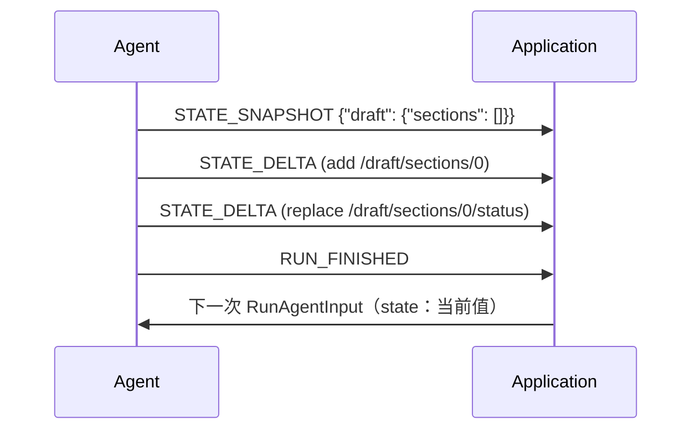

状态（state）是 Agent 与应用保持同步的值——一份计划、一张表单、一份正在构建的文档。它由[快照–增量模式（snapshot–delta pattern）](../basic/patterns/snapshots.md)承载；本页补充状态特有的内容，以及对话自身那份快照（snapshot）特有的内容。

## 事件（event）

### `STATE_SNAPSHOT`

整体替换 Agent 的状态。在增量（delta）无法表达该变更时发送，或用于让消费者（consumer）重新同步。消费者必须（MUST）用 `snapshot` 替换自己的状态——不做合并。

### `STATE_DELTA`

用 RFC 6902 patch 修改当前状态。基线是消费者当前的状态：在一次运行（run）开始时，是输入的 `state`；此后，则是这次运行自己的快照与增量所造就的任何结果。[模式](../basic/patterns/snapshots.md)关于 patch 的一切——原子应用、开放的操作、失败处理、重新同步——原样适用。

### `MESSAGES_SNAPSHOT`

生产者（producer）拥有的完整消息（message）集合，按顺序。

它作用于整个对话，而不是一次普通的覆盖，因为消费者可能持有任何生产者都不跟踪的、属于自己的消息。对账规则：

- 快照中的一条消息替换消费者中 id 相同的副本——*就地*替换：消费者为它已经持有的消息保留现有位置。消费者从未见过的快照消息会按快照顺序追加。因此，快照的顺序只对消费者首次遇到的消息具有权威性；它不会重排消费者已有的内容。
- 消费者持有、但在快照中*缺席*的消息会被丢弃——生产者是在声明完整集合——**例外**是生产者无从知晓的、仅属于客户端（client）的材料：[活动（activity）](activity.md)消息，它们从不发往生产者；以及推理消息，大多数生产者不跟踪它们。
- 这一例外按角色生效，并且会自我撤销：一个自身携带任何活动消息的快照，就是在声明完整的活动集合，消费者中不在其中的活动消息会像其他任何东西一样被丢弃。同样的规则适用于推理消息。

由于作用于整个对话，快照不携带自己的 `subagentRunId`；它通过所含的消息确立每条消息的所有权。

## 跨运行（run）行为

状态在一个线程（thread）上的多次运行之间持续存在，直到有事件（event）替换它；下一次运行的输入把它作为起始值带回——这个循环让双方保持一致。消息以同样的方式累积；`MESSAGES_SNAPSHOT` 是生产者直接重述这种累积的方式。

## 消息流

## 数据类型

[`StateSnapshotEvent`](../schema.md#statesnapshotevent)、[`StateDeltaEvent`](../schema.md#statedeltaevent) 与 [`MessagesSnapshotEvent`](../schema.md#messagessnapshotevent) 由 [schema 参考](../schema.md)定义，其中 [`State`](../schema.md#state) 被有意保持不受约束——可以是任何 JSON 值，而不只是对象——增量则是 [`JsonPatch`](../schema.md#jsonpatch)。

## 错误处理

结构上畸形的 patch 是致命的；一个格式良好但应用失败的 patch 会告警并被跳过，依据[模式](../basic/patterns/snapshots.md#当补丁无法应用时)。

## 安全考量

状态事件是对应用状态的远程写入。应用必须（MUST）在依据从状态中读出的内容行事之前校验它——渲染它、执行它、因它而授予任何东西——正如它会校验任何其他跨越信任边界的输入那样。反过来，生产者不应（SHOULD NOT）把机密放进状态：每次运行它都要经由消费者往返一次。
