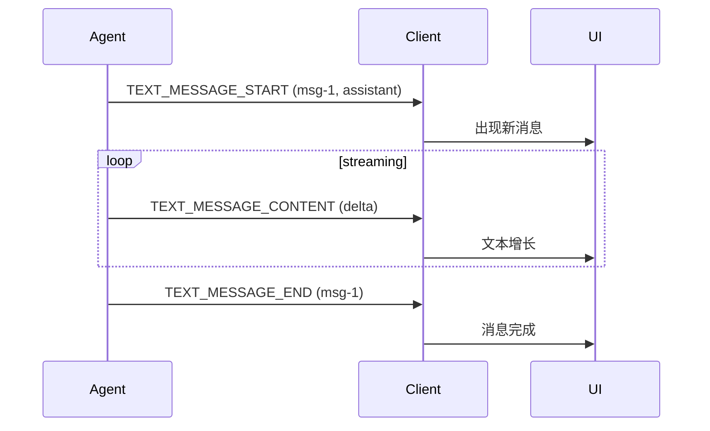

文本消息（text message）就是对话本身：用户读到的话。生产者（producer）在每条消息（message）生成时把它流式（streaming）送出，这样 UI 可以在文本到达时就渲染，而不是等这条消息（message）完成。

## 用户交互模型

文本消息（text message）通常被渲染为聊天的对话记录（transcript），每条消息（message）随其内容流式（streaming）到达而逐步出现。协议（protocol）不强制任何特定的呈现方式——消费者（consumer）可以（MAY）先缓冲整条消息（message）再显示，也可以逐 token 渲染。

## 事件（event）

文本消息（text message）遵循[流式模式（streaming pattern）](../basic/patterns/streaming.md)，以 `messageId` 匹配。该模式的规则——先开启再给内容、在运行（run）结束前关闭、不得重新开启一个已打开的 id——按那里所写的适用。

### `TEXT_MESSAGE_START`

开启一条消息（message）。

```json
{
  "type": "TEXT_MESSAGE_START",
  "messageId": "msg-1",
  "role": "assistant"
}
```

- `role` 是可选（OPTIONAL）的；角色（role）缺席表示 `assistant`。角色（role）可以取哪些值由 [schema](../schema.md#textmessagerole) 规定。
- `name` 是可选（OPTIONAL）的，在角色（role）之内标注说话者，适用于要区分多个说话者的生产者（producer）。

### `TEXT_MESSAGE_CONTENT`

扩展已打开的消息（message）。`delta` 携带这条消息（message）文本的下一段；增量（delta）按到达顺序拼接。

```json
{
  "type": "TEXT_MESSAGE_CONTENT",
  "messageId": "msg-1",
  "delta": "Hello, world."
}
```

### `TEXT_MESSAGE_END`

关闭这条消息（message）。已关闭的消息（message）是关闭的，而不是封死的：生产者（producer）可以（MAY）用一个新的 `TEXT_MESSAGE_START` 重新开启同一个 `messageId`，这条消息（message）便继续，其后续内容追加到已有内容之后。重新开启的 `TEXT_MESSAGE_START` 必须（MUST）与它所重新开启的消息（message）一致——同一个所有者（owner）、同一个 `role`、同一个 `name`；消息（message）既定的取值保持不变，消费者（consumer）不必去检测这种不一致。之后的 [`MESSAGES_SNAPSHOT`](state.md) 也可以（MAY）整体重述这条消息（message）。而任何事件（event）都做不到的，是以其他任何方式改变一条已关闭消息（message）的内容。

> [!NOTE]
> 在一次运行（run）之内，以不同所有者（owner）重新开启，正是[子 Agent 规则（subagent rules）](subagents.md)已经拒绝的归属（attribution）不匹配。跨运行（run）时，消费者（consumer）的所有权（ownership）跟踪已经重置，这就是为什么不要求检测跨运行（run）的不一致——生产者（producer）的义务在两种情况下是相同的。

### `TEXT_MESSAGE_CHUNK`

紧凑写法。消费者（consumer）必须（MUST）按[流式模式（streaming pattern）](../basic/patterns/streaming.md#分块chunked形式)的规定把分片（chunk）展开为上面那三个事件（event），包括首片的要求以及冲突重复的规则。

## 消息流（message flow）



## 数据类型

事件（event）的形状由 [schema 参考](../schema.md)定义：[`TextMessageStartEvent`](../schema.md#textmessagestartevent)、[`TextMessageContentEvent`](../schema.md#textmessagecontentevent)、[`TextMessageEndEvent`](../schema.md#textmessageendevent)、[`TextMessageChunkEvent`](../schema.md#textmessagechunkevent)。装配完成的消息（message）按它的角色（role）以 [`AssistantMessage`](../schema.md#assistantmessage)、[`UserMessage`](../schema.md#usermessage)、[`SystemMessage`](../schema.md#systemmessage) 或 [`DeveloperMessage`](../schema.md#developermessage) 的形式出现在对话历史中。

一条消息（message）任一事件（event）上的元数据（metadata）会按[元数据规则（metadata rules）](../basic/metadata.md)合并进该消息（message）：逐 key 合并，后写覆盖。

## 错误处理

针对一个未打开的 `messageId` 的 `TEXT_MESSAGE_CONTENT` 或 `TEXT_MESSAGE_END`，或者针对一个已打开的 `messageId` 的 `TEXT_MESSAGE_START`，都是畸形的序列，对运行（run）是致命的。运行（run）结束时仍有消息（message）保持打开，同样属于违规。这些是[流式模式（streaming pattern）](../basic/patterns/streaming.md)的规则；文本消息（text message）没有让其中任何一条变得宽松。
