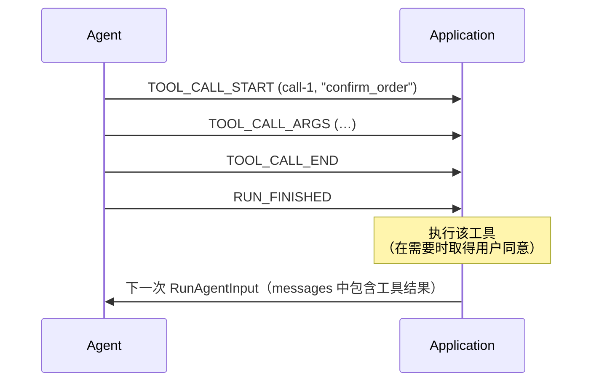

工具调用（tool call）是 Agent 请求把某件事做成。当该工具是应用（application）在其[运行输入（run input）](../basic/run-input.md)中声明过的工具时，由应用（application）来执行它——这使工具调用（tool call）成为协议（protocol）的人在回路（human in the loop）核心：Agent 提议，应用（application）处置。

## 用户交互模型

应用（application）通常会在工具调用（tool call）流式（streaming）到达时把它呈现出来——一张标明工具名称、参数（args）逐步填入的卡片——并且，对有副作用的工具，在执行前询问用户。协议（protocol）不强制任何特定的交互模型，但请参见下文的[安全考量](#安全考量)。

## 事件（event）

工具调用（tool call）遵循[流式模式（streaming pattern）](../basic/patterns/streaming.md)，以 `toolCallId` 匹配。

### `TOOL_CALL_START`

开启一个调用（call）。

```json
{
  "type": "TOOL_CALL_START",
  "toolCallId": "call-1",
  "toolCallName": "search",
  "parentMessageId": "msg-1"
}
```

- `toolCallName` 指明被调用的工具。
- `parentMessageId` 是可选（OPTIONAL）的，把该调用（call）挂到承载它的助手消息上。当父消息归属于某个子 Agent（subagent）时，该调用（call）必须（MUST）与该归属（attribution）一致——工具调用（tool call）属于承载它的那条消息（message）（见[子 Agent（subagent）](subagents.md)）。

### `TOOL_CALL_ARGS`

扩展已打开的调用（call）。`delta` 携带该调用（call）参数（args）的下一段；拼接后的增量（delta）构成该调用（call）的参数（args）文本，按惯例是一个 JSON 文档——但协议（protocol）以文本形式承载它，并不校验它，这是有意为之：各提供方（provider）会发出畸形的参数（args）字符串，让应用（application）决定如何处理，胜过让传输（transport）杀死这次运行（run）。

消费者（consumer）不得（MUST NOT）在 `TOOL_CALL_END` 之前对参数（args）采取行动：在调用（call）关闭之前，这段文本只是生产者（producer）正在发送之物的前缀，而不是它本身。

### `TOOL_CALL_END`

关闭这个调用（call）。参数（args）文本此时是完整的——关闭确立的是完整性，而非有效性。执行该工具的一方会解析它，而如何处理无法解析的文本是应用（application）的决定，不是协议（protocol）违规。

已关闭的调用（call），像已关闭的消息（message）一样，可以（MAY）被一个新的、`toolCallId` 相同的 `TOOL_CALL_START` 重新开启，后续参数（args）会追加进去。重新开启的 `TOOL_CALL_START` 必须（MUST）与它所重新开启的调用（call）一致——同一个 `toolCallName`、同一个 `parentMessageId`、同一个所有者（owner）。不要求消费者（consumer）检测不一致；而且与[重新开启的文本消息（text message）](text-messages.md#text_message_end)不同，协议（protocol）对于错过该违规的消费者（consumer）最终持有两个值中的哪一个，不作任何承诺。

### `TOOL_CALL_CHUNK`

紧凑写法。消费者（consumer）必须（MUST）按[流式模式（streaming pattern）](../basic/patterns/streaming.md#分块chunked形式)的规定展开分片（chunk）：首个分片（chunk）必须（MUST）携带 `toolCallId` 和 `toolCallName`，而续篇重复 `toolCallName` 或 `parentMessageId` 但取值冲突，是致命的。

### `TOOL_CALL_RESULT`

携带一个调用（call）的结果（result）。它本身就是一条消息（message）——一条拥有自己 `messageId` 的工具消息（tool message）——并不重新开启它所回答的那个调用（call）。

```json
{
  "type": "TOOL_CALL_RESULT",
  "messageId": "msg-2",
  "toolCallId": "call-1",
  "content": "3 results found."
}
```

结果（result）可以（MAY）与它的调用（call）出现在同一次运行（run）中——由 Agent 执行的工具——也可能根本不出现在流（stream）中：由客户端（client）执行的工具，其结果改为作为下一次运行（run）输入（input）中的一条工具消息（tool message）返回给生产者（producer）。

#### 结果内容（result content）

`content` 必须（MUST）是字符串，或者 [`ContentPart`](../schema.md#contentpart) 的有序列表——与[用户消息（user message）](../basic/run-input.md#messages)所携带的片段（part）相同：`text`、`image`、`audio`、`video` 和 `document`，每个媒体片段（part）都带一个 `source`，其为内联数据、URL 或[提供方文件句柄（provider file handle）](../basic/run-input.md#提供方文件句柄provider-file-handle)。该事件（event）所铸出的工具消息（tool message）具有完全相同的形状，因此结果（result）可以原样进入下一次运行（run）的 `messages`。

```json
{
  "type": "TOOL_CALL_RESULT",
  "messageId": "msg-2",
  "toolCallId": "call-1",
  "content": [
    { "type": "text", "text": "Invoice INV-2291 attached." },
    {
      "type": "document",
      "source": { "type": "url", "value": "https://example.com/INV-2291.pdf", "mimeType": "application/pdf" },
      "metadata": { "title": "INV-2291" }
    }
  ]
}
```

- 返回结构化数据的工具——比如一个 JSON 对象——把它序列化（serialization）为字符串形式，或一个 `text` 片段（part）。协议（protocol）没有 JSON 片段：每个提供方（provider）都接受以文本形式给出的工具结果（tool result），而一个带类型的对象无论如何都必须在提供方（provider）的边界（boundary）处变成文本。
- 片段（part）没有建模的任何东西——一次搜索命中的来源与标题、一个文档的文件名——搭该片段（part）的 `metadata` 便车。协议（protocol）不定义提供方专属的结果块（启用了引用的搜索结果、浏览器状态）；需要其中之一的生产者（producer）把它映射到这些片段（part）上，或作为透传（passthrough）携带。
- 若某个工具把它的输出上传到了模型提供方（provider）——比如一份如今存放在该提供方（provider）文件存储中的生成的报告——则返回该句柄作为 `file` 来源，而不是重新发送这些字节；与输入（input）上相同的[规则](../basic/run-input.md#提供方文件句柄provider-file-handle)适用，而渲染该结果（result）的消费者（consumer）把该句柄视为不透明的。
- 生产者（producer）若被交付一个其模型无法接收的片段（part）——给纯文本模型一张图像、给在工具结果（tool result）中不接受任何音频的提供方（provider）一段音频、或者由另一个提供方（provider）签发的文件句柄——不得（MUST NOT）因此让运行（run）失败。它丢弃该片段（part）并继续，正如[运行输入规则（run input rules）](../basic/run-input.md#messages)已经就用户内容所说的那样；并且它仍必须（MUST）回答这个调用（call）：所有片段（part）都被丢弃的结果（result），以空字符串作答，因为一个未获作答的工具调用（tool call），是大多数模型会直接拒绝的。
- 只能持有字符串的消费者（consumer）——某个渲染器、某个存储、某个旧式桥接层——把片段（part）列表按顺序渲染为其 `text` 片段（part）的拼接，并忽略其余部分。这样做是有损的，应当（SHOULD）予以告知，如同任何降级（degrade）一样（[版本（versioning）](../basic/versioning.md)）。
- 内容片段（content part）出现之前的对端（peer）不发送 `protocolVersion`；知道自己在与这样一个对端（peer）通信的生产者（producer），可以（MAY）在发出结果（result）之前以同样的方式把它压平，并且必须（MUST）在压平丢弃了某个片段（part）时告警（warning）。它不得（MUST NOT）在被丢弃片段（part）的位置放置占位符：降级（downgrade）是重塑形状，不是凭空创造。

## 前端工具（frontend tools）

[运行输入（run input）](../basic/run-input.md#tools)中的 `tools` 列表属于应用（application）：Agent 提议一个调用（call），应用（application）执行它。协议（protocol）没有从消费者（consumer）出发的运行中通道，所以这个回答只能跨越一次运行（run）的边界（boundary）——这就决定了往返的形状：

- 调用前端工具（frontend tool）的生产者（producer）不得（MUST NOT）回答它：没有 `TOOL_CALL_RESULT`，没有伪造的工具消息（tool message）。结果（result）由应用（application）产出。
- 生产者（producer）以该调用（call）未获作答的状态结束运行（run）。它必须（MUST）使用成功结果（outcome），或者不使用任何结果（outcome），且不得（MUST NOT）把这次运行（run）报告为已中断——并且，一旦不再剩下任何依赖该结果（result）的事情，它就应当（SHOULD）尽快结束。一次运行（run）可以（MAY）留下多个前端调用（call）未获作答；应用（application）会一次性把它们全部回答。
- 成功结果（outcome）的 `pendingToolCallIds` 按调用（call）发生的顺序列出未获作答的调用（call）。当一次运行（run）留下待办的调用（call）时，生产者（producer）应当（SHOULD）发送它；这样做时，该列表必须（MUST）恰好包含这次运行（run）已开始、且未用 `TOOL_CALL_RESULT` 作答的那些工具调用（tool call）。单凭 `RUN_FINISHED` 并不能说明一次运行（run）是否给应用（application）留下了工作：当列表缺席或为空时，需要知道这一点的消费者（consumer）从流（stream）中推导——这次运行（run）开始的、未收到结果（result）的每一个工具调用（tool call）——并且不得（MUST NOT）把缺席读作「没有待办」。在一次已中断（interrupt）的运行（run）上，待办调用（call）以同样的方式推导；中断（interrupt）结果（outcome）并不携带它们。
- 运行（run）结束之后，应用（application）处置每一个未获作答的前端调用（call）——执行它，或拒绝它，并遵循其自身规则所要求的任何同意。要继续的线程（thread）必须（MUST）先回答其中每一个：下一次运行（run）的 `messages` 为每个调用（call）携带一条工具消息（tool message），以 `toolCallId` 为键——失败也是一种回答，即一条设置了 `error` 的工具消息（tool message）；用户拒绝的调用（call）则通过说明这一点来回答。工具消息（tool message）的 `content` 是字符串或片段（part）列表，与 [`TOOL_CALL_RESULT`](#结果内容result-content) 上完全一样：产出了截图或选取了文件的前端工具（frontend tool），以媒体片段（part）作答，而不是对它进行描述。未获作答的调用（call）会让 Agent 停在思考中途，而带有悬空调用（call）的历史是许多模型会直接拒绝的。放弃该线程（thread）则什么都没回答，也没有违反任何东西——这条规则约束的是续跑（continuation），与恢复（resume）的覆盖范围同理。

这是与[中断（interrupt）](../basic/patterns/interrupt-resume.md)不同的一种往返：中断（interrupt）是生产者（producer）明确停下来询问，由恢复（resume）条目作答；而一次前端工具调用（frontend tool call）搭乘的是普通的消息（message）循环，由对话历史作答。

> [!NOTE]
> 因前端工具调用（frontend tool call）而停下的运行（run）是一次已完成的运行（run），不是一次已中断（interrupt）的运行（run），也不是第三种结束方式。结果（outcome）报告的是生产者（producer）所知道的、关于这次运行（run）为何结束的信息，而在这里，生产者（producer）并不知道自己是否在等待：前端工具（frontend tool）常常是一种终结性效果——渲染一张图表、导航、高亮——而它的结果（result）是否启动另一次运行（run），是应用（application）的决定，由应用（application）针对该工具（tool）的规则做出。所以生产者（producer）说出它所知道的——这次运行（run）已完成，而这些调用（call）未获作答——作为成功结果（outcome）上的细节；在那里，剥离（strip）该字段的较旧消费者（consumer）仍会读到一次成功的运行（run），并像往常一样推导出待办调用（call）。

生产者（producer）应当（SHOULD）只从已声明的列表中调用前端工具（frontend tool）；一个点名了输入（input）未声明的工具（tool）的调用（call），本身并不构成协议（protocol）违规——如何处理它是消费者（consumer）的决定。生产者（producer）自己的工具（tool）在 Agent 侧执行，从不需要声明，并通过 `TOOL_CALL_RESULT` 在流（stream）内作答。

## 消息流（message flow）

由客户端（client）执行的工具跨越两次运行（run）：



## 数据类型

事件（event）的形状由 [schema 参考](../schema.md)定义：[`ToolCallStartEvent`](../schema.md#toolcallstartevent)、[`ToolCallArgsEvent`](../schema.md#toolcallargsevent)、[`ToolCallEndEvent`](../schema.md#toolcallendevent)、[`ToolCallChunkEvent`](../schema.md#toolcallchunkevent)、[`ToolCallResultEvent`](../schema.md#toolcallresultevent)。在对话历史中，一个调用（call）以 [`ToolCall`](../schema.md#toolcall) 的形式出现在一条 [`AssistantMessage`](../schema.md#assistantmessage) 上，结果（result）则以 [`ToolMessage`](../schema.md#toolmessage) 的形式出现，其内容是字符串或 [`ContentPart`](../schema.md#contentpart) 的列表。被声明的工具（tool）是 [`RunAgentInput`](../schema.md#runagentinput) 上的 [`Tool`](../schema.md#tool) 对象。

这些片段（part）按它们本身来命名——`TextPart`、`ImagePart`——而不是按它们流动的方向命名，因为同一个片段（part）会以用户消息（user message）内的形式进入模型，也会以工具结果（tool result）内的形式从流（stream）中出来。`ReasoningPart`、`ToolCallPart` 和 `AssistantPart` 这些名称保留给后续的次版本（minor），届时助手消息也将携带片段（part）；目前没有任何东西定义它们，生产者（producer）不得（MUST NOT）发出它们。

## 错误处理

[流式模式（streaming pattern）](../basic/patterns/streaming.md)的序列规则原样适用：继续或关闭一个未打开的调用（call），或重新开启一个已打开的调用（call），都是致命的。运行（run）结束时仍有调用（call）保持打开，属于违规。

## 安全考量

工具调用（tool call）是协议（protocol）中最大的攻击面，因为它们把模型的输出变成了动作。

- 参数（args）由模型生成，必须（MUST）作为不受信任的输入处理：在有声明的参数 schema 时，按该工具声明的参数 schema 校验；在没有的时候，像审视任何不受信任的载荷那样审视；并且绝不在未经转义的情况下插入 shell 命令、查询或标记。
- 应用（application）应当（SHOULD）在执行有副作用的工具调用（tool call）之前取得用户同意，并且不得（MUST NOT）把一次并未获用户批准的调用（call）表示为已获批准。
- 工具结果（tool result）是数据，来自工具取得它们的任何地方。消费者（consumer）不得（MUST NOT）把结果（result）中的文本当作协议（protocol）材料，或当作承载用户权威的指令。
- 点名一个未声明工具（tool）的调用（call），不应（SHOULD NOT）在没有对等审视（如对待一个新工具那样）的情况下被执行。

